# Phase 1: System Requirements Specification (SRS)
**Project:** SALESTORM — High-Concurrency Flash-Sale E-Commerce Platform  
**Event:** SYSCRAFTERS 2026 (Design-First System Design Hackathon)  
**Team:** Team 1  

---

## 1. Executive Summary & System Scope

**SALESTORM** is a high-concurrency flash-sale e-commerce platform engineered to handle extreme, instantaneous traffic spikes—such as **10,000+ concurrent purchase attempts competing for exactly 100 units of inventory** (and scaling up to **500,000 req/s** at peak flash-sale admission)—while upholding absolute correctness invariants:
1. **Zero Overselling (Hard Guarantee):** `sold_quantity + reserved_quantity <= total_stock` ($100$) at every instant in time.
2. **Zero Duplicate Charges / Orders (Hard Guarantee):** Every state-mutating request is protected by two-layer idempotency (`Idempotency-Key` + database `UNIQUE` constraints).
3. **Zero Lost Paid Orders (Hard Guarantee):** Even if downstream services (e.g., `OrderService`) experience total outage for 30+ seconds immediately after payment capture, the **Transactional Outbox Pattern** and **Saga Orchestration/Choreography** ensure every paid purchase eventually reaches `CONFIRMED` or is safely compensated/refunded.

---

## 2. Canonical Domain Glossary (Single Source of Truth)

To ensure 100% consistency across High-Level Design (HLD), Low-Level Design (LLD), Database DDL, OpenAPI specs, and ADRs, all phases adhere strictly to the following canonical names:

| Concept | Canonical Names Used Across All Phases |
| :--- | :--- |
| **Core Services** | `CatalogService`, `CartService`, `InventoryService`, `ReservationService`, `CheckoutFacade`, `PaymentService`, `OrderService`, `FulfilmentService`, `ShipmentService`, `NotificationService` |
| **Background Workers** | `ExpirySweeperWorker`, `OutboxPublisherWorker`, `PaymentReconciliationWorker`, `StockReconciliationWorker` |
| **Reservation States** | `AVAILABLE` *(logical pre-state)* $\rightarrow$ `RESERVED` $\rightarrow$ `PAYMENT_PENDING` $\rightarrow$ `CONFIRMED` $\rightarrow$ `SOLD` \| Failure/Expiry: `PAYMENT_FAILED`, `TIMEOUT`, `RELEASED` |
| **Order States** | `CREATED` $\rightarrow$ `PAYMENT_PENDING` $\rightarrow$ `CONFIRMED` $\rightarrow$ `PROCESSING` $\rightarrow$ `SHIPPED` $\rightarrow$ `OUT_FOR_DELIVERY` $\rightarrow$ `DELIVERED` \| Failure/Recovery: `CANCELLED`, `REFUND_PENDING`, `REFUNDED` |
| **Payment States** | `INITIATED` $\rightarrow$ `PENDING` $\rightarrow$ `SUCCESS` \| `FAILED` \| `TIMEOUT_UNKNOWN` $\rightarrow$ `RECONCILED_SUCCESS` / `RECONCILED_FAILED` \| `REFUNDED` |
| **Core Database Tables** | `customer`, `category`, `product`, `sale_deal`, `coupon`, `cart`, `cart_item`, `inventory`, `inventory_reservation`, `payment`, `orders`, `order_item`, `shipment`, `notification`, `outbox_event`, `audit_log` |
| **Domain Events** | `InventoryReserved`, `ReservationExpired`, `ReservationReleased`, `PaymentInitiated`, `PaymentSucceeded`, `PaymentFailed`, `OrderRequested`, `OrderConfirmed`, `OrderCancelled`, `ShipmentDispatched`, `ShipmentDelivered` |

---

## 3. End-to-End Functional Requirements (FRs)

The functional requirements cover the complete 11-stage customer journey:
$$\text{Customer} \rightarrow \text{Discovery} \rightarrow \text{Cart} \rightarrow \text{Inventory Check} \rightarrow \text{Reservation} \rightarrow \text{Checkout} \rightarrow \text{Payment} \rightarrow \text{Order} \rightarrow \text{Fulfilment} \rightarrow \text{Shipment} \rightarrow \text{Notification \& Tracking}$$

```mermaid
flowchart LR
    C["1. Customer (Auth & Context)"] --> D["2. Discovery (Browse & Deals)"]
    D --> CA["3. Cart (Add & Pricing)"]
    CA --> IC["4. Inventory Check (Fast-Path Gate)"]
    IC --> R["5. Reservation (Atomic Hold + TTL)"]
    R --> CH["6. Checkout (Quote & Token)"]
    CH --> P["7. Payment (Idempotent Charge)"]
    P --> O["8. Order (Outbox & State)"]
    O --> F["9. Fulfilment (Pick & Pack)"]
    F --> S["10. Shipment (Carrier & Dispatch)"]
    S --> NT["11. Notification & Live Tracking"]
```

### 3.1 Stage 1: Customer & Access Management (`Customer`)
* **FR-CUST-01 (Web/Mobile Access):** The system shall allow customers to access the platform over HTTPS via web and mobile clients through a CDN/WAF and API Gateway.
* **FR-CUST-02 (Authentication & Context):** The system shall authenticate customers using stateless JWTs (OAuth2 / OIDC) and propagate `customer_id`, `session_id`, and `role` in the request context.
* **FR-CUST-03 (Admission Control & Waiting Room):** During flash sales, the edge layer shall enforce per-user/IP rate limits and place excess burst traffic into a fair Virtual Waiting Room queue before admitting requests to the checkout/reservation pipeline.

### 3.2 Stage 2: Product & Flash-Sale Discovery (`Discovery`)
* **FR-DISC-01 (Catalog Browsing):** Customers shall browse products by category, search keywords, and active flash-sale campaigns (`sale_deal`).
* **FR-DISC-02 (Product Metadata):** The system shall maintain and serve product details (`product_id`, `sku`, `name`, `description`, `base_price`, `sale_price`, `category_id`, and approximate stock badge).
* **FR-DISC-03 (Edge/Cache Serving):** Product catalog reads and flash-sale countdown pages shall be served from CDN and Redis read caches so 99% of read traffic never touches the relational database.

### 3.3 Stage 3: Cart & Pricing Management (`Cart`)
* **FR-CART-01 (Cart CRUD):** Customers shall add items to their cart, update quantities (subject to per-customer flash-sale purchase limits, e.g., max 1 unit per customer), or remove items.
* **FR-CART-02 (Total & Coupon Calculation):** The system shall calculate subtotal, applicable flash-sale discounts (`sale_deal`), promotional `coupon` rules, taxes, and final payable amount.
* **FR-CART-03 (Flash-Sale Direct Buy Bypass):** For single-item flash sales ("Buy Now"), the system shall support an express path that constructs an ephemeral checkout context directly without requiring multi-step cart persistence.

### 3.4 Stage 4: Inventory Check (`Inventory Check`)
* **FR-INV-01 (Stock Accounting):** The system shall track `total_stock`, `available_quantity`, `reserved_quantity`, and `sold_quantity` per `product_id`, enforcing the strict conservation law:
  $$\text{available\_quantity} + \text{reserved\_quantity} + \text{sold\_quantity} = \text{total\_stock}$$
* **FR-INV-02 (Pre-Purchase Availability Gate):** Before creating a reservation, the system shall execute an atomic fast-path check-and-decrement in Redis (via Lua script) backed by conditional SQL updates in PostgreSQL (`WHERE available_quantity >= :qty`).
* **FR-INV-03 (Cache-to-DB Reconciliation):** The system shall continuously reconcile Redis stock counters against PostgreSQL inventory records (`StockReconciliationWorker`) and alert on any drift that persists beyond active transaction windows (`> 10s`).

### 3.5 Stage 5: Inventory Reservation (`Reservation`)
* **FR-RES-01 (Atomic Temporary Hold):** When a customer clicks "Buy Now", the system shall atomically decrement `available_quantity` and increment `reserved_quantity`, creating an `inventory_reservation` record with status `RESERVED`.
* **FR-RES-02 (Idempotent Reservation):** Every `POST /api/v1/reservations` call **must** supply an `Idempotency-Key` header. Retries with the same key for an active reservation shall return the existing reservation (`200 OK`) without double-decrementing stock; if the reservation was already released/expired, it shall return `410 Gone` and allow a fresh key.
* **FR-RES-03 (Reservation TTL & Expiry Sweeper):** Each reservation shall have a strict Time-To-Live (`expires_at = created_at + 600s` [10 minutes] in production; configurable to `5s` in simulation). `ExpirySweeperWorker` shall detect expired `RESERVED` holds (`status = 'RESERVED' AND expires_at < NOW()`), transition them through `TIMEOUT` $\rightarrow$ `RELEASED`, and atomically restore `available_quantity` in both PostgreSQL and Redis while invalidating the expired idempotency key in Redis.

### 3.6 Stage 6: Checkout Orchestration (`Checkout`)
* **FR-CHK-01 (Checkout Session Binding):** `CheckoutFacade` (`POST /api/v1/checkout`) shall validate that the customer holds an active, non-expired `reservation_id`, lock the final pricing/tax quote, and transition the reservation to `PAYMENT_PENDING`.
* **FR-CHK-02 (TTL Extension Guard):** Once payment is actively initiated (`PAYMENT_PENDING`), a grace window (`+60 seconds`) prevents `ExpirySweeperWorker` from releasing stock mid-flight. If a `PAYMENT_PENDING` row exceeds its grace window, it is routed to `PaymentReconciliationWorker` rather than blindly released.

### 3.7 Stage 7: Payment Processing (`Payment`)
* **FR-PAY-01 (External Gateway Integration):** `PaymentService` (`POST /api/v1/payments`) shall initiate payment charges via an external payment gateway adapter using tokenized payment methods (never storing raw PAN/CVV).
* **FR-PAY-02 (Payment Idempotency & Unique Reference):** Every payment request requires a distinct `Idempotency-Key` and enforces `UNIQUE(reservation_id)` on active/successful charges, guaranteeing a customer is never charged twice for the same reservation.
* **FR-PAY-03 (Success, Failure & Timeout Handling):**
  * **On Payment Success:** In a **single local ACID transaction**, verify the reservation is still in `PAYMENT_PENDING`, update `payment.status = 'SUCCESS'`, transition reservation `PAYMENT_PENDING` $\rightarrow$ `CONFIRMED` $\rightarrow$ `SOLD` (decrementing `reserved_quantity` and incrementing `sold_quantity`), and insert an `OrderRequested` event into `outbox_event`. (If a late payment arrives after the reservation was already released, abort settlement and trigger an immediate automated Gateway Refund).
  * **On Payment Failure:** Transition `payment.status = 'FAILED'`, reservation `PAYMENT_PENDING` $\rightarrow$ `PAYMENT_FAILED` $\rightarrow$ `RELEASED`, and atomically restore `available_quantity + 1` in PostgreSQL and Redis.
  * **On Gateway Timeout (`TIMEOUT_UNKNOWN`):** Mark payment `TIMEOUT_UNKNOWN`, hold the reservation in `PAYMENT_PENDING`, and trigger `PaymentReconciliationWorker` to query the gateway status API before deciding to confirm or release.

### 3.8 Stage 8: Order Management (`Order`)
* **FR-ORD-01 (Asynchronous Reliable Order Creation):** `OrderService` consumes `OrderRequested` events (published by `OutboxPublisherWorker` via Kafka) and creates a durable record in `orders` and `order_item` with `UNIQUE(reservation_id)` deduplication.
* **FR-ORD-02 (Strict Order Lifecycle State Machine):** Orders shall transition strictly through valid states: `CREATED` $\rightarrow$ `PAYMENT_PENDING` $\rightarrow$ `CONFIRMED` $\rightarrow$ `PROCESSING` $\rightarrow$ `SHIPPED` $\rightarrow$ `OUT_FOR_DELIVERY` $\rightarrow$ `DELIVERED` (plus `CANCELLED` $\rightarrow$ `REFUND_PENDING` $\rightarrow$ `REFUNDED`). Invalid transitions shall be rejected with `InvalidStateTransitionError`.
* **FR-ORD-03 (Downstream Outage Resilience):** If `OrderService` is down (e.g., for 30 seconds during a flash sale), `OutboxPublisherWorker` trips its Circuit Breaker (`OPEN`), buffers `OrderRequested` events safely in the `outbox_event` table / Kafka topic, and drains them automatically upon recovery so zero paid orders are lost.

### 3.9 Stage 9: Order Fulfilment (`Fulfilment`)
* **FR-FUL-01 (Warehouse Allocation):** Upon `OrderConfirmed`, `FulfilmentService` transitions the order to `PROCESSING`, allocates physical warehouse bin stock, and generates a pick-pack manifest.

### 3.10 Stage 10: Shipment Management (`Shipment`)
* **FR-SHP-01 (Carrier Booking & Tracking):** `ShipmentService` books a delivery partner via a pluggable `IShippingPartnerAdapter`, records `carrier_name`, `tracking_number`, and `estimated_delivery`, and transitions the order to `SHIPPED`.
* **FR-SHP-02 (Delivery Webhooks):** Webhook updates from logistics partners advance the shipment and order state to `OUT_FOR_DELIVERY` and `DELIVERED`.

### 3.11 Stage 11: Notification & Live Tracking (`Notification & Tracking`)
* **FR-NOT-01 (Event-Driven Notifications):** `NotificationService` subscribes asynchronously to domain events (`OrderConfirmed`, `PaymentFailed`, `ShipmentDispatched`, `ShipmentDelivered`) to send idempotent email, SMS, and push notifications.
* **FR-TRK-01 (Customer Order & Shipment Tracking):** Customers can poll or subscribe via SSE/WebSockets to track real-time reservation, payment, order, and shipment status.

---

## 4. Measurable Non-Functional Requirements (NFRs)

### 4.1 Hard Guarantees vs. Service Level Objectives (Targets)

> [!IMPORTANT]
> **Hard Guarantees (Invariants)** must hold 100% of the time under all failure modes (network retries, server crashes, DB failovers, 50× traffic spikes). **Targets (SLOs)** are statistical performance and availability goals under defined capacity envelopes.

| ID | Category | Metric / Requirement | Specification | Classification |
| :--- | :--- | :--- | :--- | :--- |
| **NFR-INV-01** | **Consistency** | **Zero Overselling** | `sold_quantity + reserved_quantity <= total_stock` ($100$) at all times; `available_quantity >= 0` enforced by Redis Lua gate + DB `CHECK` constraint. | **HARD GUARANTEE** |
| **NFR-IDM-01** | **Consistency** | **Zero Duplicate Reservations** | Concurrent or sequential requests with identical `Idempotency-Key` create at most 1 reservation and decrement stock at most once. | **HARD GUARANTEE** |
| **NFR-IDM-02** | **Consistency** | **Zero Duplicate Charges / Orders** | At most 1 successful payment charge and 1 order per `reservation_id`, enforced via gateway idempotency key and DB `UNIQUE(reservation_id)`. | **HARD GUARANTEE** |
| **NFR-REL-01** | **Reliability** | **No Lost Paid Orders** | 100% of payments that succeed at the gateway eventually result in either a `CONFIRMED` order or an automated compensating refund (`REFUNDED`). | **HARD GUARANTEE** |
| **NFR-REL-02** | **Reliability** | **No Leaked Stock on Failure** | 100% of failed payments and expired reservations (`TTL > 10m`) eventually transition to `RELEASED` and restore `available_quantity` exactly once. | **HARD GUARANTEE** |
| **NFR-SEC-01** | **Security** | **Zero Raw Card Storage (PCI-DSS)** | 0% of raw PAN/CVV data touches or persists in SALESTORM logs, memory, or databases; only gateway tokens (`pm_tok_*`) are handled. | **HARD GUARANTEE** |
| **NFR-THR-01** | **Throughput** | **Baseline Traffic** | Sustain **10,000 req/s** mixed read/write workload during normal peak operations, and **10,000 concurrent purchase attempts** in the flash-sale burst. | **TARGET (SLO)** |
| **NFR-THR-02** | **Throughput** | **50× Flash Peak Traffic** | Absorb up to **500,000 req/s** at the CDN / Edge / Virtual Waiting Room layer without cascading failure to core databases. | **TARGET (SLO)** |
| **NFR-LAT-01** | **Latency** | **Catalog & Stock Read Latency** | **p95 $\le$ 20 ms**, **p99 $\le$ 50 ms** (served via CDN / Redis cache). | **TARGET (SLO)** |
| **NFR-LAT-02** | **Latency** | **Inventory Reservation (`POST /api/v1/reservations`)** | **p95 $\le$ 80 ms**, **p99 $\le$ 150 ms** (fast-path Redis Lua + conditional DB write; sold-out fast rejection in **p99 $\le$ 15 ms**). | **TARGET (SLO)** |
| **NFR-LAT-03** | **Latency** | **Payment Initiation (`POST /api/v1/payments`)** | **p95 $\le$ 1,500 ms**, **p99 $\le$ 3,000 ms** (bounded by external payment gateway round-trip time; internal overhead $\le$ 50 ms). | **TARGET (SLO)** |
| **NFR-LAT-04** | **Latency** | **Async Order Confirmation** | **p95 $\le$ 2 seconds** under normal operation; **$\le$ 45 seconds** recovery drain time after a 30-second `OrderService` outage. | **TARGET (SLO)** |
| **NFR-AVL-01** | **Availability** | **Platform Uptime** | **99.99% availability** ($\le$ 52.6 minutes unplanned downtime/year) for Edge, Discovery, and Reservation APIs during flash-sale windows. | **TARGET (SLO)** |
| **NFR-DR-01** | **Disaster Recovery** | **RPO (Recovery Point Objective)** | **RPO = 0 seconds** for financial/inventory ledger (`PostgreSQL` synchronous replication to standby AZ); **RPO $\le$ 1 second** for non-critical telemetry. | **HARD GUARANTEE (Ledger) / TARGET** |
| **NFR-DR-02** | **Disaster Recovery** | **RTO (Recovery Time Objective)** | **RTO $\le$ 30 seconds** automated multi-AZ failover for Redis Cluster and PostgreSQL Primary. | **TARGET (SLO)** |

---

## 5. Architectural Decisions for Phase 1 Scope

Following Working Rule #3, every foundational requirement decision states the choice, alternatives rejected, why it fits SALESTORM, and what it sacrifices:

### Decision 1.1: Two-Step Purchase Flow (`Reserve` $\rightarrow$ `Pay` $\rightarrow$ `Async Order`) vs. Single-Step Synchronous Checkout
* **Choice:** Decouple flash-sale checkout into an ultra-fast synchronous **Inventory Reservation** step (`POST /api/v1/reservations`), followed by **Payment Capture** (`POST /api/v1/payments`), followed by asynchronous **Order Creation** via Transactional Outbox.
* **Alternatives Rejected:**
  1. *Single synchronous `POST /buy` endpoint* that locks inventory, calls the external payment gateway (1–3s latency), and writes the order inside one database transaction.
  2. *Optimistic post-payment stock deduction* (charging the customer first and checking stock after payment).
* **Why it fits SALESTORM:** Holding database locks across a 2-second external payment call under 10,000 concurrent requests exhausts connection pools instantly. Charging before reserving stock causes massive overselling and costly refund storms when 10,000 users pay for 100 items. Reserving stock first filters 10,000 users down to 100 reservation winners in milliseconds; only those 100 winners ever hit the external payment gateway!
* **What it sacrifices:** Requires a reservation state machine and a background `ExpirySweeperWorker` (TTL reaper) to reclaim stock from the ~5% of winners whose payments fail or who abandon checkout.

### Decision 1.2: Strong Consistency on Inventory Write Path vs. Eventual Consistency on Order & Notification Path
* **Choice:** Enforce strict linearizable/atomic consistency on the **Reservation & Payment Ledger** path, while using eventual consistency (Transactional Outbox + Kafka) for **Order Creation, Fulfilment, and Notifications**.
* **Alternatives Rejected:**
  1. *Strict Distributed Two-Phase Commit (2PC/XA)* across Reservation, Payment, Order, and Notification services.
  2. *Pure Eventual Consistency* across the entire pipeline (including inventory decrements).
* **Why it fits SALESTORM:** Pure eventual consistency on inventory violates the **Never Oversell** hard guarantee. Conversely, 2PC across Reservation, Payment, and Order services violates availability—if `OrderService` goes down for 30 seconds (a mandatory hackathon test scenario), 2PC blocks payments from completing. By committing Payment + Outbox Event atomically and creating the Order asynchronously, the customer's payment succeeds even while `OrderService` is down.
* **What it sacrifices:** A brief window (milliseconds in normal state, up to ~35s during an `OrderService` outage) where a customer sees *"Payment Received — Order Confirming..."* (`PAYMENT_PENDING` / `CONFIRMED` reservation) before the final `OrderConfirmed` receipt arrives.

---

## 6. Assumptions, Constraints, and External Dependencies

### 6.1 Key Assumptions
1. **Single-Unit Flash Sale Purchase Cap:** Each customer request in the core flash-sale scenario attempts to purchase `quantity = 1` of the hot SKU (`PRODUCT_X`, initial stock = `100` units), though the schema and Lua/SQL logic support parameterized quantities (`quantity >= 1`).
2. **Pre-Authenticated Traffic at Checkout:** Customers entering the flash-sale purchase flow have already authenticated and hold a valid JWT and client-generated UUIDv4 `Idempotency-Key`.
3. **Failure Rate Distribution (Hackathon Benchmark):** During the 10,000-request flash sale simulation, approximately **95%** of reservation winners succeed at payment, **5%** fail payment (releasing stock back to the pool for subsequent buyers), **2%** of total requests are network-retry duplicates with identical `Idempotency-Key`, and `OrderService` experiences a **30-second outage** mid-sale.
4. **Clock Synchronization:** Application nodes and database servers run NTP with clock drift $< 50\text{ ms}$, and authoritative reservation expiry checks use the database/Redis server clock rather than client timestamps.

### 6.2 System Constraints
1. **Strict Inventory Ceiling:** `total_stock` for the flash-sale item is fixed at `100` units during the sale window.
2. **External Payment Gateway Latency & Rate Limits:** The external payment gateway has a p99 latency of up to `3,000 ms` and enforces strict rate limits; our architecture must never flood the payment gateway with all 10,000 requests (only the $\le 100$ active reservation holders may call `/pay` at a time).
3. **Team Defensibility Constraint:** The architecture must avoid exotic, unexplainable black-box infrastructure and rely on clear, well-understood primitives (Redis atomic Lua, PostgreSQL conditional updates & ACID transactions, Kafka/Outbox, and clean OOP patterns).

### 6.3 External Dependencies
| Dependency | Role in SALESTORM | Failure Impact & Mitigation |
| :--- | :--- | :--- |
| **External Payment Gateway** (e.g., Stripe / Razorpay) | Processes tokenized customer charges and refunds. | Mitigated via timeouts (`3s`), Circuit Breaker, `Idempotency-Key` forwarding, and `PaymentReconciliationWorker` for `TIMEOUT_UNKNOWN` states. |
| **External Logistics / Carrier APIs** (e.g., Delhivery / FedEx) | Generates tracking numbers and dispatches physical packages. | Asynchronous via `ShipmentService`; failures retry via Kafka consumer backoff without affecting checkout or order confirmation. |
| **External Notification Providers** (e.g., SES / Twilio / FCM) | Delivers email, SMS, and push alerts to customers. | Asynchronous via `NotificationService`; non-blocking to core transaction lifecycle. |

---

## 7. Requirements Traceability Matrix (Preview Across Phases)

| Requirement Group | Covered In Phase(s) | Primary Artifacts |
| :--- | :--- | :--- |
| **Full 11-Stage Pipeline & NFRs** | Phase 1, Phase 2 | `01_Requirements/requirements.md`, `02_HLD/hld_architecture.md` |
| **Zero Overselling & Concurrency** | Phase 3, Phase 7, Phase 10 | `03_LLD/inventory_reservation.md`, `04_Database/schema.sql`, `11_AI_Assisted_Validation/` |
| **Payment Idempotency & 30s Outage Recovery** | Phase 4, Phase 5, Phase 10 | `03_LLD/payment_order.md`, `03_LLD/low_level_design.md` |
| **SOLID & Extensibility (Patterns)** | Phase 6 | `06_SOLID/solid_principles.md`, `07_Design_Patterns/design_patterns.md` |
| **50× Traffic Scaling & Observability** | Phase 2, Phase 8, Phase 9 | `08_Scalability_Reliability/`, `09_Security_Observability/`, `10_ADR/` |
