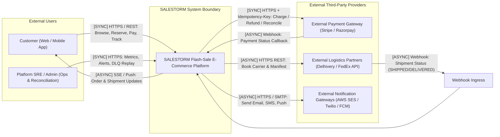
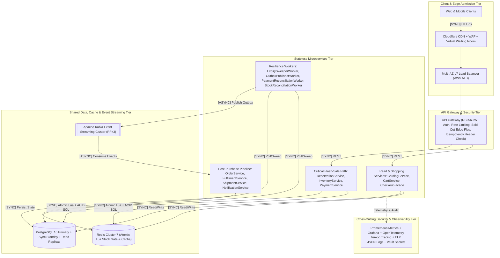
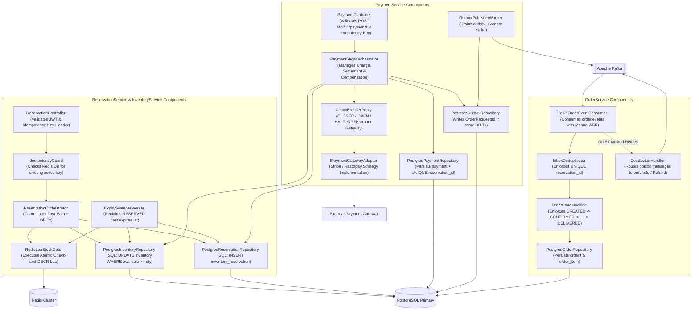
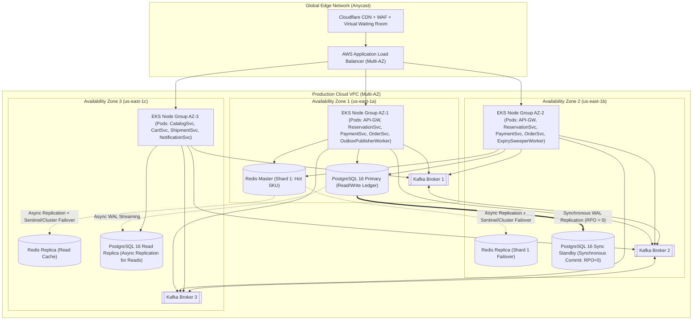
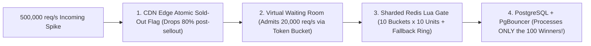

# Phase 2: High-Level Design (HLD)
**Project:** SALESTORM — High-Concurrency Flash-Sale E-Commerce Platform  
**Event:** SYSCRAFTERS 2026 (Design-First System Design Hackathon)  
**Team:** Team 1  

---

## 1. Architectural Philosophy: The "Traffic Funnel" Strategy

When **10,000 customers click "Buy Now" at the exact same millisecond** (or **500,000 req/s** at 50× flash peak) for **100 units**, passing all requests straight to a relational database or an external payment gateway causes catastrophic connection-pool exhaustion and cascading timeouts.

SALESTORM solves this by designing the architecture as a **4-Stage Traffic Funnel**, shedding load at the cheapest, fastest layer first:
1. **Stage 1 — Edge & Virtual Waiting Room (500,000 req/s $\rightarrow$ 10,000 req/s):** CDN serves 99% of static/catalog reads. WAF blocks bots. The Virtual Waiting Room issues signed admission tokens at a controlled rate so backend services are never overwhelmed.
2. **Stage 2 — Fast-Path Inventory Gate in Redis (10,000 req/s $\rightarrow$ 100 winners):** A single-threaded atomic Lua script in Redis evaluates `idempotency_key` and decrements `stock:{product_id}` in $<1\text{ ms}$. Exactly **100 requests win** and proceed; **9,900 requests are rejected (`409 SOLD_OUT`) at the memory layer** without ever touching PostgreSQL write locks.
3. **Stage 3 — Source-of-Truth Reservation & Payment (100 winners only):** Only the 100 Redis winners hit PostgreSQL to persist an `inventory_reservation` row (`WHERE available_quantity >= 1`) and call the External Payment Gateway (`POST /api/v1/payments`).
4. **Stage 4 — Asynchronous Order & Post-Purchase Pipeline ($\le$ 100 events):** Payment confirmation writes an `OrderRequested` event to `outbox_event` in the same local DB transaction. `OutboxPublisherWorker` streams events via **Apache Kafka** to `OrderService`, `FulfilmentService`, `ShipmentService`, and `NotificationService`.

---

## 2. Diagram 1: System Context Diagram (C4 Level 1)

Shows SALESTORM as a system in its environment, highlighting external actors, third-party systems, and **Synchronous (`[SYNC]`) vs. Asynchronous (`[ASYNC]`)** boundaries.

---

## 3. Diagram 2: High-Level Design (HLD) Architectural Tiers Overview

Separates the macro architectural tiers (Edge & Admission, API Gateway, Core Domain Microservices, Shared State/Messaging Infrastructure, External Providers, and Observability) before zooming into C4 Level 2 containers.

---

## 4. Diagram 3: Container / Service Architecture Diagram (C4 Level 2)

Shows all edge infrastructure, microservices, background workers, caching, message broker, and data stores, with every call explicitly labeled **`[SYNC]`** or **`[ASYNC]`** and canonical `/api/v1/...` paths.

```mermaid
flowchart TB
    CUST["Customer Client (Web / Mobile)"]

    subgraph Edge["Edge & Admission Tier"]
        CDN["Cloudflare CDN & WAF (Static Cache, Bot/DDoS Shield)"]
        VWR["Virtual Waiting Room (Token-Bucket Queue Admission)"]
        LB["L7 Load Balancer (AWS ALB / NGINX)"]
        APIGW["API Gateway (JWT Auth, Rate Limit, Idempotency Check)"]
    end

    subgraph Services["Core Microservices Tier (Stateless K8s Pods)"]
        CAT["CatalogService (Product & Sale Discovery)"]
        CART["CartService (Cart & Pricing Rules)"]
        CHK["CheckoutFacade (Checkout Orchestration)"]
        RES["ReservationService (Fast-Path Gate + Hold)"]
        INV["InventoryService (Stock Ledger & Reconciliation)"]
        PAY["PaymentService (Gateway Charge & Outbox)"]
        ORD["OrderService (Order State Machine)"]
        FUL["FulfilmentService (Warehouse Pick & Pack)"]
        SHP["ShipmentService (Carrier Booking & Tracking)"]
        NOT["NotificationService (Email / SMS / Push)"]
    end

    subgraph Workers["Background Workers Tier"]
        EXPW["ExpirySweeperWorker (TTL Reaper: RESERVED -> TIMEOUT -> RELEASED)"]
        OUTW["OutboxPublisherWorker (Polls outbox_event -> Kafka)"]
        RECW["PaymentReconciliationWorker (Resolves TIMEOUT_UNKNOWN)"]
        STKW["StockReconciliationWorker (Redis vs PostgreSQL Drift Check)"]
    end

    subgraph Data["Data, Cache & Messaging Tier"]
        REDIS[("Redis Cluster 7 (Atomic Lua Stock Gate, Idempotency & Catalog Cache)")]
        PG_PRI[("PostgreSQL 16 Primary (ACID Source of Truth: Inventory, Reservation, Payment, Orders, Outbox, Audit)")]
        PG_REP[("PostgreSQL 16 Read Replicas (Catalog, Order History Queries)")]
        KAFKA[["Apache Kafka Cluster (Topics: order.events, payment.events, inventory.events, notification.events, order.dlq)"]]
    end

    subgraph Ext["External Providers"]
        EXT_PG["External Payment Gateway"]
        EXT_SHP["External Carrier API"]
        EXT_NOT["SES / Twilio / FCM"]
    end

    CUST -- "[SYNC] HTTPS" --> CDN
    CDN -- "[SYNC] Dynamic API" --> VWR
    VWR -- "[SYNC] Admitted Token" --> LB
    LB -- "[SYNC] HTTP/2" --> APIGW

    APIGW -- "[SYNC] GET /api/v1/products" --> CAT
    APIGW -- "[SYNC] POST /api/v1/cart/items" --> CART
    APIGW -- "[SYNC] POST /api/v1/reservations" --> RES
    APIGW -- "[SYNC] POST /api/v1/checkout" --> CHK
    APIGW -- "[SYNC] POST /api/v1/payments" --> PAY
    APIGW -- "[SYNC] GET /api/v1/orders/{order_id}" --> ORD

    CAT -- "[SYNC] Cache-Aside Read" --> REDIS
    CAT -- "[SYNC] Fallback Read" --> PG_REP
    CART -- "[SYNC] Read/Write Cart" --> REDIS
    CART -- "[SYNC] Persist Cart" --> PG_PRI
    CHK -- "[SYNC] Verify Reservation" --> RES

    RES -- "[SYNC] 1. Atomic Lua Gate (Check Idempotency + DECR)" --> REDIS
    RES -- "[SYNC] 2. Conditional UPDATE + INSERT reservation" --> PG_PRI
    INV -- "[SYNC] Manage Stock" --> PG_PRI

    PAY -- "[SYNC] 1. Lock Reservation (PAYMENT_PENDING)" --> PG_PRI
    PAY -- "[SYNC] 2. Charge via CircuitBreaker" --> EXT_PG
    PAY -- "[SYNC] 3. ACID Tx: Payment + Sold Stock + outbox_event" --> PG_PRI
    PAY -- "[SYNC] 4. On Failure: Lua INCR + DEL IdemKey" --> REDIS

    EXPW -- "[SYNC] Reclaim Expired RESERVED" --> PG_PRI
    EXPW -- "[SYNC] Restore Redis Stock" --> REDIS
    RECW -- "[SYNC] Query Unknown Tx" --> EXT_PG
    RECW -- "[SYNC] Settle Payment" --> PG_PRI
    STKW -- "[SYNC] Compare Counts (>10s drift)" --> REDIS
    STKW -- "[SYNC] Compare Counts" --> PG_PRI
    OUTW -- "[SYNC] Read Pending Outbox" --> PG_PRI
    OUTW -- "[ASYNC] Publish Events" --> KAFKA

    KAFKA -- "[ASYNC] Consume OrderRequested" --> ORD
    ORD -- "[SYNC] ACID Create Order + Emit OrderConfirmed" --> PG_PRI
    KAFKA -- "[ASYNC] Consume OrderConfirmed" --> FUL
    FUL -- "[SYNC] Update PROCESSING" --> PG_PRI
    KAFKA -- "[ASYNC] Trigger Shipment" --> SHP
    SHP -- "[SYNC] Book Tracking" --> EXT_SHP
    SHP -- "[SYNC] Save Shipment" --> PG_PRI
    KAFKA -- "[ASYNC] Consume Domain Events" --> NOT
    NOT -- "[ASYNC] Dispatch Alerts" --> EXT_NOT
```

---

## 5. Diagram 4: Component Diagram (C4 Level 3 — Critical Path Services)

Zooms into the internal components of **`InventoryService`**, **`ReservationService`**, **`PaymentService`**, and **`OrderService`** to show where validation, idempotency, atomic gates, circuit breakers, and outbox handlers live.

---

## 6. Diagram 5: Multi-AZ Production Deployment Diagram

Shows how SALESTORM is deployed across 3 Availability Zones (AZ-1, AZ-2, AZ-3) on Kubernetes (EKS) with synchronous database replication (`RPO = 0`) for the financial/inventory ledger and a 3-broker Kafka cluster (`replication.factor = 3`, `min.insync.replicas = 2`).

---

## 7. Architectural Decisions & Justifications (Working Rule #3)

### Decision 2.1: Edge Admission Control & Virtual Waiting Room
* **Choice:** Cloudflare Edge Rate Limiting + Token-Bucket Virtual Waiting Room (`VWR`) ahead of the L7 Load Balancer and API Gateway.
* **Alternatives Rejected:**
  1. *No waiting room (letting all 500,000 req/s hit Kubernetes API Gateway pods directly).*
  2. *Scaling Kubernetes pods to handle 500,000 concurrent HTTP connections synchronously.*
* **Why it fits SALESTORM:** Flash sales produce extreme, short-lived traffic spikes (10,000 to 500,000 req/s in a 5-second window). Queueing excess visitors at the edge via lightweight signed JWT admission tokens protects internal connection pools, prevents TLS handshake exhaustion on the ALB, and provides a fair FIFO waiting experience for users.
* **What it sacrifices:** Adds a lightweight token verification step at the API Gateway and places late-arriving burst users into a short waiting-room poll (`HTTP 202 Accepted - Queue Position`) during 50× spikes.

### Decision 2.2: Two-Tier Inventory Gate (Redis Atomic Lua Gate + PostgreSQL Conditional Update)
* **Choice:** Use a **Redis Atomic Lua Script** as the fast-path admission gate (`stock:{product_id}` check-and-decrement + idempotency check in one atomic script) backed by **PostgreSQL Conditional Atomic Update** (`UPDATE inventory SET available_quantity = available_quantity - 1, reserved_quantity = reserved_quantity + 1 WHERE product_id = $1 AND available_quantity > 0`) as the durable source of truth.
* **Alternatives Rejected:**
  1. *PostgreSQL-only reservation (`SELECT ... FOR UPDATE` on all 10,000 requests):* Serializes 10,000 transactions on a single hot row (`product_id = PRODUCT_X`), causing lock-wait queues, high p99 latency, and connection pool saturation.
  2. *Redis-only inventory without database constraints:* Fast, but if a Redis primary node crashes before replication completes, async replication could lose a recent decrement and cause overselling.
* **Why it fits SALESTORM:** Combining both gives us the speed of Redis and the ACID safety of PostgreSQL. When 10,000 requests arrive, Redis rejects 9,900 of them in $<1\text{ ms}$ in memory. **Only the 100 winners ever execute a write transaction on PostgreSQL!** And even if Redis were bypassed or drifted, PostgreSQL's `WHERE available_quantity > 0` and `CHECK (available_quantity >= 0)` guarantee **zero overselling**.
* **What it sacrifices:** Requires compensating Redis `INCR` if a PostgreSQL transaction fails or a reservation expires, plus a periodic `StockReconciliationWorker` to verify `Redis stock == PostgreSQL available_quantity`.

### Decision 2.3: Transactional Outbox + Apache Kafka + Choreography/Orchestration Hybrid Saga
* **Choice:** `PaymentService` acts as the synchronous orchestrator for the payment call, commits the payment status + inventory `SOLD` transition + `outbox_event` row in **one PostgreSQL ACID transaction**, and publishes `OrderRequested` via `OutboxPublisherWorker` to **Apache Kafka** for `OrderService` to consume asynchronously.
* **Alternatives Rejected:**
  1. *Synchronous REST call from `PaymentService` to `OrderService` (`POST /api/v1/orders`) right after payment succeeds.*
  2. *Direct dual-write (`COMMIT` to PostgreSQL followed by `kafkaProducer.send()` in application memory).*
* **Why it fits SALESTORM:** If `OrderService` is down for 30 seconds (mandatory hackathon scenario), a synchronous REST call fails after the customer's card was already charged, leaving the system in an inconsistent state. A direct dual-write to Kafka can also lose messages if the pod crashes between `DB.commit()` and `Kafka.send()`. The **Transactional Outbox Pattern** guarantees atomic persistence of both the payment state and the outgoing event.
* **What it sacrifices:** Introduces a background `OutboxPublisherWorker` and requires `OrderService` consumers to be idempotent (`UNIQUE(reservation_id)`).

---

## 8. Contention Control, Bottlenecks & 50× Traffic Evolution

### 8.1 Exact Point Where Inventory Contention is Controlled
Inventory contention is controlled at **two exact choke points**:
1. **Primary Fast-Path Choke Point (In-Memory):** Inside `RedisLuaStockGate` on the Redis Cluster shard owning key `{product:PRODUCT_X}:stock`. Because Redis executes Lua scripts atomically on a single event-loop thread, 10,000 concurrent requests are serialized in memory at $\sim 100,000+\text{ ops/sec}$ ($\le 0.1\text{ ms}$ per script). The first 100 distinct `Idempotency-Key` requests decrement the counter from `100` to `0` and return `1` (Win); the remaining 9,900 requests immediately see `0` and return `0` (`409 SOLD_OUT`).
2. **Authoritative Ledger Choke Point (On-Disk ACID):** Inside PostgreSQL Primary on the `inventory` table row `WHERE product_id = 'PRODUCT_X' AND available_quantity >= 1`. Because the Redis gate already filtered out 99% of requests, PostgreSQL only ever sees $\sim 100$ write transactions (plus occasional re-reservations when the ~5% failed payments release stock), eliminating row-lock thrashing completely.

### 8.2 Likely Bottlenecks & How Each Scales

| Component / Layer | Why It Could Bottleneck | How SALESTORM Scales It |
| :--- | :--- | :--- |
| **1. Single Hot Key in Redis (`{product:PRODUCT_X}:stock`)** | All requests for the same flash-sale item route to the single Redis shard owning that key (~100k–150k Lua ops/s limit per core). | **Inventory Token Sharding with Fallback Ring Probe:** Split a single hot SKU into $N=10$ logical Redis buckets (`stock:PRODUCT_X:bucket_0` .. `bucket_9`, 10 units each). Requests probe `bucket = hash(customer_id) % 10` first; if that bucket hits `0` while global residual stock $> 0$, `ReservationOrchestrator` probes the fallback ring `(bucket + i) % 10` so zero units are ever stranded in a single shard! |
| **2. PostgreSQL Primary Connection Pool & Row Lock** | High-volume concurrent writes on a single row cause `LWLock:buffer_content` and row-lock waits; excessive pods exhaust `max_connections`. | **PgBouncer Transaction Pooling + Fast-Path Gate:** Redis blocks 99% of losers from touching PostgreSQL. PgBouncer multiplexes thousands of pod connections onto 100 DB connections. For multi-SKU sales, partition `inventory` by `hash(product_id)`. |
| **3. External Payment Gateway Latency (1–3s RTT)** | Synchronous HTTP calls hold worker threads open; gateway outages cause thread-pool starvation. | **Async I/O (Non-blocking event loop) + Circuit Breaker + Pre-Reservation Filter:** Only the $\le 100$ reservation holders can call `/api/v1/payments`. A 3-state Circuit Breaker trips `OPEN` if gateway errors/timeouts spike, failing fast (`503`) and protecting worker pools. |
| **4. Outbox Table Polling Overhead** | High-frequency polling of `outbox_event` adds read load to PostgreSQL Primary. | **SKIP LOCKED Batching:** `OutboxPublisherWorker` uses `SELECT ... WHERE status='PENDING' ORDER BY created_at LIMIT 100 FOR UPDATE SKIP LOCKED` indexed by partial B-tree index `idx_outbox_pending_poll` (with optional evolution to Debezium WAL CDC at hyperscale). |

### 8.3 What Changes at 50× Traffic (10,000 req/s $\rightarrow$ 500,000 req/s)?

When traffic scales $50\times$ from **10,000 req/s** to **500,000 req/s**, the downstream capacity for a 100-unit flash sale does *not* need to increase by $50\times$ (because we are still only selling 100 units!); instead, **rejection and admission capacity** must scale $50\times$:

1. **Edge-Cached "Sold-Out" Short-Circuit (Cloudflare Workers / Edge KV):** As soon as all 10 Redis buckets hit `0` (typically within the first 50–100 milliseconds of the sale), `ReservationService` broadcasts a `StockDepleted` flag to the API Gateway and CDN Edge KV (with a 1-second TTL, cleared immediately if `ExpirySweeperWorker` or `PaymentService` releases stock). Subsequent requests among the 500,000 req/s receive `409 SOLD_OUT` **directly at the CDN Edge** in $<5\text{ ms}$ with zero origin traffic.
2. **Sharded Redis Inventory Buckets with Fallback Ring:** Instead of 1 Redis key handling 500,000 Lua calls/sec, the 100 units are pre-split across **10 Redis Cluster shards** (`10 shards × 10 units = 100 units`). If a customer's primary hash bucket (`customer_id % 10`) is `0` while global stock remains $> 0$, the service probes adjacent buckets in the ring so no single unit is ever stranded.
3. **Stateless Tier Auto-Scaling (HPA):** `API Gateway` and `ReservationService` Kubernetes pods scale horizontally from 10 pods to 150+ pods via KEDA / HPA based on incoming RPS, while `PaymentService` and `OrderService` stay compact because they only ever process the 100 reservation winners.
