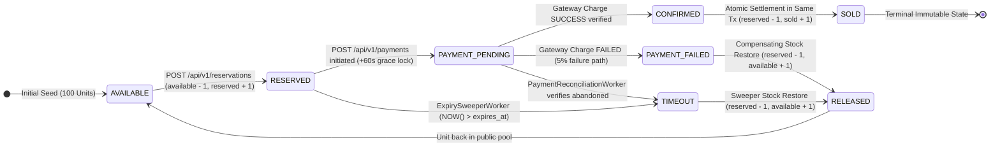
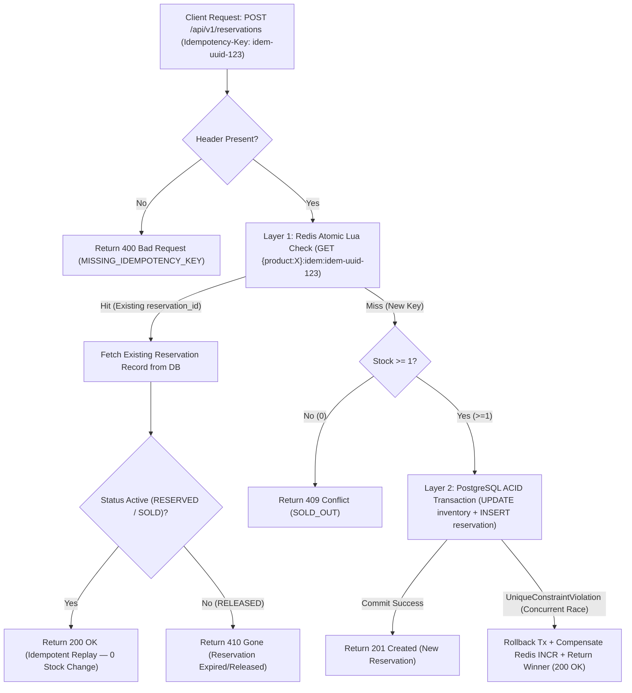

# Phase 3: Concurrency & Inventory Reservation Design
**Project:** SALESTORM — High-Concurrency Flash-Sale E-Commerce Platform  
**Event:** SYSCRAFTERS 2026 (Design-First System Design Hackathon)  
**Team:** Team 1  

---

## 1. Concurrency Control Comparison & Strategy Selection

When **10,000 concurrent requests** arrive within milliseconds for **100 units** of `PRODUCT_X`, a naive read-then-write (`SELECT available_quantity` followed by `UPDATE`) suffers from classic **Time-Of-Check to Time-Of-Use (TOCTOU)** race conditions, resulting in massive overselling.

Below we evaluate **5 concurrency control approaches** and justify SALESTORM's selected architecture.

### 1.1 Comparative Matrix of Concurrency Approaches

| Approach | Mechanism | Latency at 10k Concurrency | Oversell Risk | Primary Failure / Bottleneck Mode | Verdict for SALESTORM |
| :--- | :--- | :--- | :--- | :--- | :--- |
| **1. Optimistic Locking (Read + Version Check)** | `SELECT qty, version` $\rightarrow$ `UPDATE ... WHERE version = old_version` | Very High (Retry Storm) | Zero | **99.9% Abort / Retry Storm:** Out of 10,000 concurrent readers seeing `version = 1`, 1 succeeds and 9,999 fail with `StaleObjectStateException` and must retry in a loop, melting the DB CPU. | **Rejected** for initial reservation gate (used only as secondary audit column). |
| **2. Pessimistic Locking (`SELECT ... FOR UPDATE`)** | Acquires exclusive row-level lock (`X-Lock`) before reading and updating. | High (Lock Queueing) | Zero | **Connection Pool Starvation:** Serializes all 10,000 requests on a single DB row lock. Even at 0.5ms per transaction, 10,000 queued transactions take 5+ seconds and exhaust `max_connections`. | **Rejected** as primary gate (supported in simulation for benchmark comparison). |
| **3. Queue-Serialized Per Product (Actor / Partition)** | Enqueues all 10,000 requests into a single Kafka partition per `product_id`; 1 worker drains sequentially. | Medium–High (Async Polling) | Zero | **Breaks Synchronous UX:** Turns a synchronous "Reserve Now" click into an asynchronous polling loop (`202 Accepted`), adding client complexity and broker lag under 500k RPS. | **Rejected** for reservation (used downstream for `OrderService`). |
| **4. DB-Only Atomic Conditional Update** | Single SQL statement: `UPDATE inventory SET available = available - 1, reserved = reserved + 1 WHERE product_id = $1 AND available >= 1` | Low–Medium ($\le$ 10k RPS) | Zero | **Disk / WAL Contention at 50× Spike:** Eliminates read-then-write round trips, works well up to ~10k RPS, but 500,000 RPS still overwhelms PostgreSQL network/connection buffers. | **Selected as Layer 2 (Authoritative Ledger Gate).** |
| **5. Hybrid: Redis Atomic Lua Gate + PostgreSQL Conditional Update** | **Layer 1:** Redis Lua script checks idempotency & decrements `stock > 0` in RAM.<br/>**Layer 2:** Only the 100 winners execute Approach #4 in PostgreSQL. | **Ultra-Low (`p99 < 15ms` for losers, `< 80ms` for winners)** | **Zero (Dual-Enforced)** | Requires compensating Redis `INCR` + `DEL idem_key` if DB transaction fails or reservation expires, plus background drift reconciliation. | **SELECTED ARCHITECTURE** |

---

### 1.2 Architectural Decision (Working Rule #3): Concurrency Control Selection

* **Choice:** **Two-Layer Hybrid Atomic Gate** combining **Layer 1: Redis Single-Threaded Atomic Lua Script** (`RedisLuaStockGate`) as the fast-path filter, and **Layer 2: PostgreSQL Conditional Atomic Update** (`WHERE available_quantity >= :qty`) with `CHECK (available_quantity >= 0)` as the ACID source of truth.
* **Alternatives Rejected:**
  1. *Application-level Optimistic Locking (`WHERE version = :v` with retry loops)* — rejected due to $O(N^2)$ retry amplification when 10,000 threads collide on version 1.
  2. *Database Pessimistic Locking (`SELECT ... FOR UPDATE` across all 10,000 requests)* — rejected because holding row locks across two SQL round-trips queues 9,900 doomed requests inside PostgreSQL's lock manager.
  3. *Queue-Serialized Reservation* — rejected because customers expect immediate synchronous feedback (`201 Created` vs `409 SOLD_OUT`) when clicking "Buy Now".
* **Why it fits SALESTORM:** Redis processes the Lua script atomically in RAM in $\sim 0.05\text{ ms}$, immediately rejecting the 9,900 excess requests with `409 SOLD_OUT` before they ever open a PostgreSQL transaction. Only the **100 winning requests** hit PostgreSQL, where a single lock-minimal conditional `UPDATE ... WHERE available_quantity >= 1` + `INSERT INTO inventory_reservation` commits in one ACID transaction.
* **What it sacrifices:** Introduces cache-to-DB state coordination: if a pod crashes after Redis `DECR` but before PostgreSQL `COMMIT`, Redis could temporarily under-report stock by 1 unit (fail-safe: **under-selling by 1 briefly, never overselling**), which is automatically healed by `StockReconciliationWorker` after verifying the drift persists beyond active transaction timeouts (`> 10s`).

---

### 1.3 Exact Implementation of the Two-Layer Atomic Gate

#### Layer 1A: Redis Atomic Reserve Lua Script (`RedisLuaStockGate.tryReserve`)
Executed via `EVALSHA` on key `{product:PRODUCT_X}:stock` and `{product:PRODUCT_X}:idem:{idempotency_key}`:

```lua
-- KEYS[1] = "{product:PRODUCT_X}:stock"
-- KEYS[2] = "{product:PRODUCT_X}:idem:" .. idempotency_key
-- ARGV[1] = requested_quantity (1)
-- ARGV[2] = reservation_id (UUID)
-- ARGV[3] = idempotency_ttl_seconds (86400)

-- Step 1: Fast-path Idempotency check
local existing_res = redis.call('GET', KEYS[2])
if existing_res then
    return {2, existing_res} -- Code 2: IDEMPOTENT_REPLAY (do not decrement again!)
end

-- Step 2: Distinguish uninitialized/restarted Redis key (nil) from genuine zero ("0")
local raw_stock = redis.call('GET', KEYS[1])
if not raw_stock then
    return {-1, "CACHE_MISS"} -- Code -1: Redis restarted / unseeded -> Single-flight seed from PostgreSQL!
end

-- Step 3: Atomic Stock Check & Decrement
local current_stock = tonumber(raw_stock)
local qty = tonumber(ARGV[1])

if current_stock >= qty then
    redis.call('DECRBY', KEYS[1], qty)
    redis.call('SET', KEYS[2], ARGV[2], 'EX', tonumber(ARGV[3]))
    return {1, ARGV[2]}      -- Code 1: RESERVED_WINNER
else
    return {0, "SOLD_OUT"}   -- Code 0: SOLD_OUT (fast reject)
end
```

#### Layer 1B: Redis Atomic Release Lua Script (`RedisLuaStockGate.releaseStock`)
Executed when a PostgreSQL reservation rolls back, a payment fails (`402`), or `ExpirySweeperWorker` reclaims an expired reservation. It restores the stock unit **at most once** (`SETNX` guard) and **deletes the expired/failed `Idempotency-Key`** (`KEYS[3]`) so a stale key never points to a dead reservation:

```lua
-- KEYS[1] = "{product:PRODUCT_X}:stock"
-- KEYS[2] = "{product:PRODUCT_X}:release:" .. reservation_id
-- KEYS[3] = "{product:PRODUCT_X}:idem:" .. idempotency_key
-- ARGV[1] = released_quantity (1)

if redis.call('SETNX', KEYS[2], '1') == 1 then
    redis.call('EXPIRE', KEYS[2], 86400)
    redis.call('INCRBY', KEYS[1], tonumber(ARGV[1]))
    redis.call('DEL', KEYS[3])
    return 1 -- Restored exactly once
else
    return 0 -- Already released (idempotent no-op)
end
```

#### Layer 2: PostgreSQL Authoritative Conditional Update (`PostgresInventoryRepository`)
Executed inside a single local database transaction **only** when Layer 1 returns `Code 1 (RESERVED_WINNER)` (or on `Code -1 (CACHE_MISS)` fallback):

```sql
BEGIN TRANSACTION ISOLATION LEVEL READ COMMITTED;

-- Step 1: Conditional Atomic Update (No prior SELECT needed; version increments atomically)
UPDATE inventory
SET available_quantity = available_quantity - 1,
    reserved_quantity  = reserved_quantity + 1,
    version            = version + 1,
    updated_at         = CURRENT_TIMESTAMP
WHERE product_id = 'PRODUCT_X'
  AND available_quantity >= 1;

-- Step 2: Check affected rows (if rowcount == 0, rollback & return 409 SOLD_OUT)
-- Step 3: Insert Reservation with UNIQUE(idempotency_key)
INSERT INTO inventory_reservation (
    reservation_id, product_id, customer_id, quantity,
    status, idempotency_key, expires_at, created_at, updated_at
) VALUES (
    $1, 'PRODUCT_X', $2, 1,
    'RESERVED', $3, CURRENT_TIMESTAMP + INTERVAL '10 minutes',
    CURRENT_TIMESTAMP, CURRENT_TIMESTAMP
);

COMMIT;
```

---

## 2. Reservation Lifecycle & State Machine

### 2.1 State Diagram (`Mermaid`)

Every unit of inventory reserved by a customer progresses through a strict, acyclic state machine from initial hold (`RESERVED`) to either final purchase (`CONFIRMED` $\rightarrow$ `SOLD`) or stock reclamation (`PAYMENT_FAILED` / `TIMEOUT` $\rightarrow$ `RELEASED`).



### 2.2 State Transition Rules & Guard Conditions

| Current State | Next State | Trigger / Actor | Inventory Ledger Delta ($\Delta$) | Guard Condition (`WHERE` clause) |
| :--- | :--- | :--- | :--- | :--- |
| `AVAILABLE` *(pool)* | `RESERVED` | `ReservationService` (`POST /api/v1/reservations`) | `available - 1`, `reserved + 1` | `available_quantity >= 1` AND unique `idempotency_key` |
| `RESERVED` | `PAYMENT_PENDING` | `PaymentService` (`POST /api/v1/payments` start) | $\Delta = 0$ (held in `reserved`) | `status = 'RESERVED' AND expires_at > NOW()` |
| `PAYMENT_PENDING` | `CONFIRMED` $\rightarrow$ `SOLD` | `PaymentService` (Gateway `SUCCESS`) | `reserved - 1`, `sold + 1` | `status = 'PAYMENT_PENDING'` (transitions through `CONFIRMED` to `SOLD` in same ACID Tx) |
| `PAYMENT_PENDING` | `PAYMENT_FAILED` $\rightarrow$ `RELEASED` | `PaymentService` (Gateway `FAILED`) | `reserved - 1`, `available + 1` | `status = 'PAYMENT_PENDING'` (transitions through `PAYMENT_FAILED` to `RELEASED` in same ACID Tx) |
| `RESERVED` | `TIMEOUT` $\rightarrow$ `RELEASED` | `ExpirySweeperWorker` (TTL Reaper) | `reserved - 1`, `available + 1` | `status = 'RESERVED' AND expires_at < NOW()` (Note: expired `PAYMENT_PENDING` rows are routed to `PaymentReconciliationWorker` first!) |

---

## 3. Reservation TTL, Multi-Worker Expiry Sweeper & Stock Release

### 3.1 Reservation TTL & Separation of `RESERVED` vs. `PAYMENT_PENDING` Expiry
* **Production TTL:** `600 seconds` (10 minutes) from reservation creation (`expires_at = created_at + INTERVAL '10 minutes'`).
* **Simulation / Hackathon Test TTL:** Configurable via `RESERVATION_TTL_SECONDS`.
* **Critical Race Prevention (`HIGH-01` Audit Guard):**
  * `ExpirySweeperWorker` **only** directly reclaims rows where `status = 'RESERVED' AND expires_at < NOW()`.
  * If a row is in `status = 'PAYMENT_PENDING'` (meaning a payment gateway call was initiated) and its `+60s` grace window expires, `ExpirySweeperWorker` does **not** blindly release its stock; instead, `PaymentReconciliationWorker` queries the external payment gateway first to confirm whether the charge succeeded or failed before settling as `SOLD` or `TIMEOUT` $\rightarrow$ `RELEASED`.

### 3.2 Multi-Worker Safe Expiry Sweeper (`ExpirySweeperWorker`)
To prevent **double-release race conditions** across multiple worker pods, `ExpirySweeperWorker` executes a **single atomic CTE with `FOR UPDATE SKIP LOCKED`**, recording `release_reason = 'TIMEOUT'` and transitioning to `'RELEASED'`:

```sql
WITH expired_batch AS (
    SELECT reservation_id, product_id, quantity, idempotency_key
    FROM inventory_reservation
    WHERE status = 'RESERVED'
      AND expires_at < CURRENT_TIMESTAMP
    ORDER BY expires_at ASC
    LIMIT 100
    FOR UPDATE SKIP LOCKED
),
updated_reservations AS (
    UPDATE inventory_reservation r
    SET status         = 'RELEASED',
        release_reason = 'TIMEOUT',
        version        = r.version + 1,
        updated_at     = CURRENT_TIMESTAMP
    FROM expired_batch e
    WHERE r.reservation_id = e.reservation_id
      AND r.status = 'RESERVED'
    RETURNING r.reservation_id, r.product_id, r.quantity, r.idempotency_key
),
restored_agg AS (
    SELECT product_id, SUM(quantity) AS total_restored
    FROM updated_reservations
    GROUP BY product_id
)
UPDATE inventory i
SET reserved_quantity  = i.reserved_quantity - ra.total_restored,
    available_quantity = i.available_quantity + ra.total_restored,
    version            = i.version + 1,
    updated_at         = CURRENT_TIMESTAMP
FROM restored_agg ra
WHERE i.product_id = ra.product_id
RETURNING i.product_id, ra.total_restored;
```

---

## 4. Two-Layer Idempotency Handling (`Idempotency-Key`)



---

## 5. Transaction Boundaries & Formal Invariant Proof

### 5.1 Strict Transaction Boundaries
SALESTORM never spans a database transaction across an external network call:

| Operation | Transaction Boundary (`BEGIN` ... `COMMIT`) | External I/O Inside DB Tx? |
| :--- | :--- | :--- |
| **T1: Reserve Stock** | `UPDATE inventory (avail - 1, res + 1)` + `INSERT inventory_reservation ('RESERVED')` | **NONE** (Redis Lua runs *before* DB Tx opens). |
| **T2: Initiate Payment** | `UPDATE inventory_reservation SET status = 'PAYMENT_PENDING' WHERE status = 'RESERVED'` + `INSERT payment ('PENDING')` | **NONE** (Commits *before* calling Stripe/Razorpay). |
| **T3a: Settle Payment (Success)** | `UPDATE inventory_reservation SET status = 'CONFIRMED' -> 'SOLD' WHERE status = 'PAYMENT_PENDING'` (**assert `rowcount == 1`**) + `UPDATE payment ('SUCCESS')` + `UPDATE inventory (res - 1, sold + 1)` + `INSERT outbox_event ('OrderRequested')` | **NONE** (Runs *after* gateway HTTP response returns). |
| **T3b: Settle Payment (Failure)** | `UPDATE inventory_reservation SET status = 'RELEASED', release_reason = 'PAYMENT_FAILED' WHERE status = 'PAYMENT_PENDING'` (**assert `rowcount == 1`**) + `UPDATE payment ('FAILED')` + `UPDATE inventory (res - 1, avail + 1)` | **NONE** (Redis `releaseStock` Lua runs *after* DB Tx commits). |
| **T4: Expire Reservation** | `UPDATE inventory_reservation SET status = 'RELEASED', release_reason = 'TIMEOUT' WHERE status = 'RESERVED'` + `UPDATE inventory (res - 1, avail + 1)` | **NONE** (Redis `releaseStock` Lua runs *after* DB Tx commits). |

---

### 5.2 Formal Invariant Proof: `sold + reserved <= 100` (Zero Overselling)

Let $S_0 = 100$ be the initial stock of `PRODUCT_X`. At any committed state $t \ge 0$, let $A(t) = \text{available\_quantity}$, $R(t) = \text{reserved\_quantity}$, and $D(t) = \text{sold\_quantity}$.

**Theorem:** For all $t \ge 0$, $R(t) + D(t) \le 100$ and $A(t) \ge 0$.

**Proof by Induction over Committed Transactions:**
1. **Base Case ($t = 0$):** $(A(0), R(0), D(0)) = (100, 0, 0) \implies A(0) + R(0) + D(0) = 100$ and $R(0) + D(0) = 0 \le 100$.
2. **Inductive Hypothesis:** Assume at step $t = k$, $A(k) + R(k) + D(k) = 100$ and $A(k), R(k), D(k) \ge 0$.
3. **Inductive Step ($t = k + 1$):**
   * **Transition 1 (`T1`):** $(\Delta A, \Delta R, \Delta D) = (-1, +1, 0)$, guarded by `WHERE available_quantity >= 1`. Thus $\sum \Delta = 0$ and $A(k+1) \ge 0$.
   * **Transition 2 (`T3a`):** $(\Delta A, \Delta R, \Delta D) = (0, -1, +1)$, guarded by `WHERE reservation_id = $1 AND status = 'PAYMENT_PENDING'` returning `rowcount == 1`. Thus $\sum \Delta = 0$ and $R(k+1) \ge 0$.
   * **Transition 3 (`T3b` / `T4`):** $(\Delta A, \Delta R, \Delta D) = (+1, -1, 0)$, guarded by conditional status update returning `rowcount == 1`. Thus $\sum \Delta = 0$ and $R(k+1) \ge 0$.
4. **Conclusion:** Since $A(t) + R(t) + D(t) = 100$ and $A(t) \ge 0$ at all $t$, $R(t) + D(t) = 100 - A(t) \le 100 \quad \blacksquare$

---

## 6. Step-by-Step Walkthrough: "Two Requests for the Last Unit"

**Scenario:** 99 units of `PRODUCT_X` are already reserved or sold (`available_quantity = 1`, `reserved_quantity = 9`, `sold_quantity = 90`, `version = 189`).
**Customer Alice** (`cust_A`, `Idempotency-Key: key_A`) and **Customer Bob** (`cust_B`, `Idempotency-Key: key_B`) both click **"Buy Now"** (`POST /api/v1/reservations`) for the **100th (last) unit** at the exact same microsecond ($t = 0.00\text{ ms}$).

```mermaid
sequenceDiagram
    autonumber
    participant Alice as Customer Alice (cust_A)
    participant Bob as Customer Bob (cust_B)
    participant ResA as ReservationService Pod 1
    participant ResB as ReservationService Pod 2
    participant Redis as Redis Cluster (Lua Gate)
    participant PG as PostgreSQL Primary (inventory)

    Note over Redis,PG: Initial State: Redis stock = 1 | PG available = 1, reserved = 9, sold = 90, version = 189

    par Simultaneous Arrival at t = 0.00 ms
        Alice->>ResA: POST /api/v1/reservations (Idempotency-Key: key_A)
        Bob->>ResB: POST /api/v1/reservations (Idempotency-Key: key_B)
    end

    ResA->>Redis: EVALSHA reserve_lua (key_A, qty=1)
    ResB->>Redis: EVALSHA reserve_lua (key_B, qty=1)

    Note over Redis: Single-threaded Lua serialization: key_A decrements 1 -> 0 (WINNER); key_B sees 0 (SOLD_OUT)

    Redis-->>ResA: {1, "res_A"} (WINNER)
    Redis-->>ResB: {0, "SOLD_OUT"} (LOSER)

    ResB-->>Bob: 409 Conflict {"error_code": "SOLD_OUT"}
    Note over Bob: Bob rejected at t = 1.2 ms in RAM without touching PostgreSQL

    ResA->>PG: BEGIN; UPDATE inventory SET available=available-1, reserved=reserved+1, version=version+1 WHERE product_id='PRODUCT_X' AND available_quantity >= 1;
    Note over PG: Updates to available=0, reserved=10, sold=90, version=190 (rowcount=1)
    ResA->>PG: INSERT INTO inventory_reservation (res_A, 'RESERVED', key_A, expires_at=NOW()+10m); COMMIT;
    PG-->>ResA: COMMIT OK
    ResA-->>Alice: 201 Created {"reservation_id": "res_A", "status": "RESERVED"}
```

### Defense-in-Depth Trace (If Both Reached PostgreSQL Directly)
1. Pod 1 (`Tx_A`) and Pod 2 (`Tx_B`) both issue `UPDATE inventory ... WHERE product_id = 'PRODUCT_X' AND available_quantity >= 1`.
2. PostgreSQL grants the row-level `ExclusiveLock` to `Tx_A`; `Tx_B` waits on `Tx_A`'s `XID`.
3. `Tx_A` updates `available_quantity` from `1` to `0`, inserts `res_A`, and commits.
4. PostgreSQL wakes `Tx_B`, re-evaluates `WHERE available_quantity >= 1` against the newly committed tuple (`0 >= 1` is `FALSE`), and returns `rowcount == 0`.
5. Pod 2 rolls back `Tx_B` and returns `409 Conflict (SOLD_OUT)` to Bob. Zero overselling.
