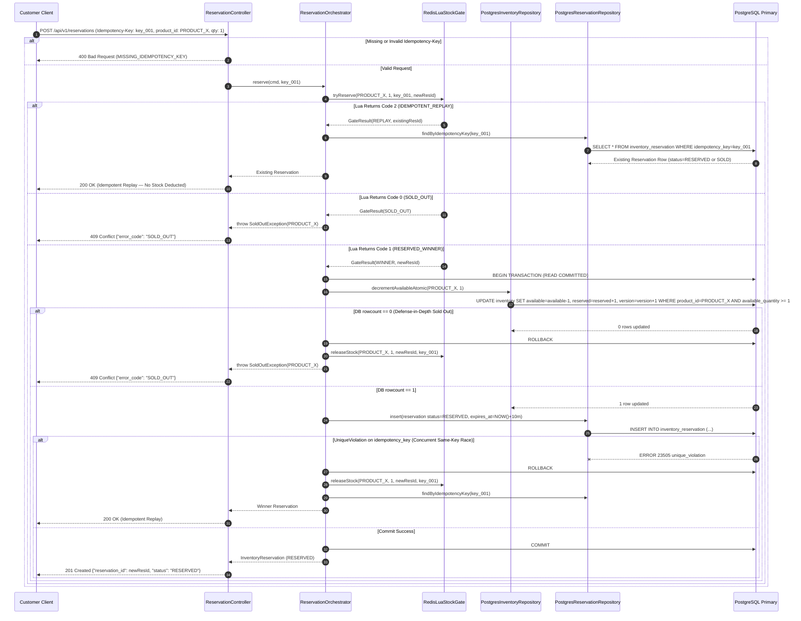
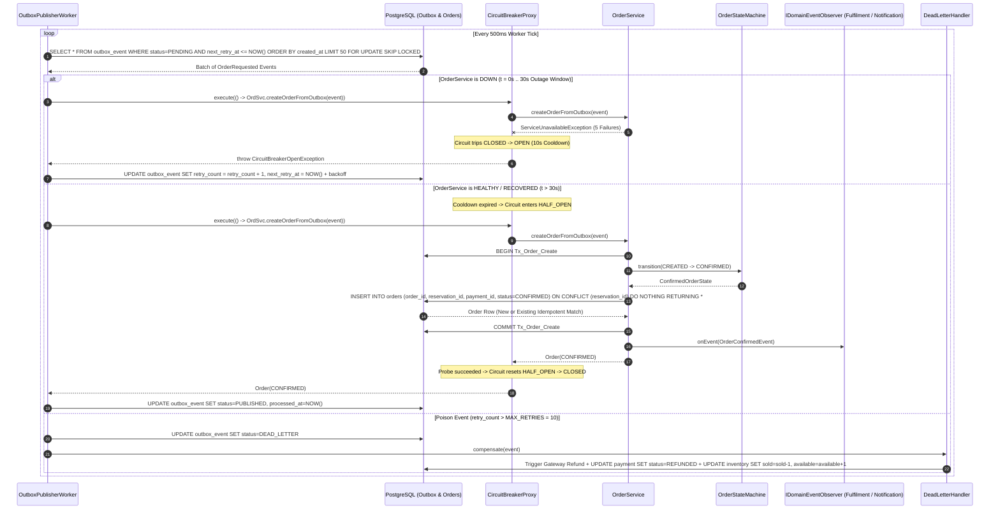
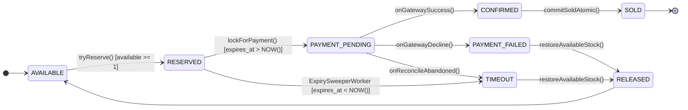
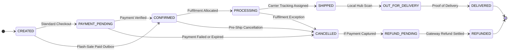
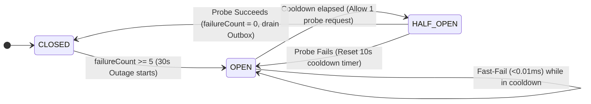

# Phase 5: Low-Level Design (LLD) — Class, Sequence & State Blueprints
**Project:** SALESTORM — High-Concurrency Flash-Sale E-Commerce Platform  
**Event:** SYSCRAFTERS 2026 (Design-First System Design Hackathon)  
**Team:** Team 1  

---

## 1. Layered Responsibility Matrix: Where Validation, Idempotency & Error Handling Live

| Concern | Architectural Layer | Exact Class & Method | Mechanism / Behavior |
| :--- | :--- | :--- | :--- |
| **1. Schema, Header & JWT Validation** | API / Controller Layer | `ReservationController.reserve()`<br/>`PaymentController.pay()` | Validates presence and UUID format of `Idempotency-Key` header (`400 Bad Request`), validates `quantity >= 1`, and extracts authenticated `customer_id` from JWT (`401 Unauthorized`). |
| **2. Fast-Path Idempotency & Stock Gate** | Domain Service / Gate Layer | `IdempotencyGuard.checkOrLock()`<br/>`RedisLuaStockGate.tryReserve()` | Executes single-threaded Redis Lua script checking `{product:X}:idem:{key}`. Returns existing `reservation_id` (`200 OK`) on active replay; returns `-1` (`CACHE_MISS`) on unseeded key; decrements stock (`1`) or rejects (`0` $\rightarrow$ `409 SOLD_OUT`) in $<1\text{ ms}$. |
| **3. Authoritative DB Idempotency & Stock Invariant** | Persistence / Repository Layer | `PostgresInventoryRepository.decrementAvailableAtomic()`<br/>`PostgresReservationRepository.insert()` | Enforces SQL `WHERE available_quantity >= :qty`, DB constraint `CHECK (available_quantity >= 0)`, and `UNIQUE(idempotency_key)` (`UniqueConstraintViolation` rolls back & returns winner's record). |
| **4. Payment Duplicate & State Lock** | Saga Orchestrator Layer | `PaymentSagaOrchestrator.processPayment()` | Locks reservation via `UPDATE ... SET status='PAYMENT_PENDING' WHERE status='RESERVED' AND expires_at > NOW()` (`410 Gone` if expired; `409 Conflict` if already paying/paid). |
| **5. External Gateway Fault Isolation** | Infrastructure / Resilience Layer | `CircuitBreakerProxy.execute()`<br/>`IPaymentGatewayAdapter.charge()` | Wraps external HTTP calls with a `3,000 ms` timeout and 3-state machine (`CLOSED` $\rightarrow$ `OPEN` after 5 failures $\rightarrow$ `HALF_OPEN` after 10s cooldown). Maps socket timeouts to `TIMEOUT_UNKNOWN`. |
| **6. State Transition Validation** | Domain Model Layer | `OrderStateMachine.transitionTo()`<br/>`Order.transitionTo()` | Uses the **State Pattern** (`IOrderState` hierarchy across all 10 states) to validate transitions (e.g., `CREATED` $\rightarrow$ `DELIVERED` throws `InvalidStateTransitionError` $\rightarrow$ `422 Unprocessable Entity`). |
| **7. Downstream Outage Recovery & DLQ** | Background Worker Layer | `OutboxPublisherWorker.drainPendingEvents()`<br/>`DeadLetterHandler.compensate()` | Polls `outbox_event` (`FOR UPDATE SKIP LOCKED`), applies exponential backoff ($2^n\text{s} + \text{jitter}$) when `OrderService` is down for 30s, and triggers automated refund after `MAX_RETRIES = 10`. |
| **8. Global Exception Mapping** | API Middleware Layer | `GlobalExceptionHandler.handle()` | Maps domain exceptions (`SoldOutException` $\rightarrow$ `409`, `DuplicateRequestException` $\rightarrow$ `200`, `ReservationExpiredException` $\rightarrow$ `410`, `CircuitBreakerOpenException` $\rightarrow$ `503`) into standard RFC-7807 error JSON. |

---

## 2. Class Diagram (Mermaid + Link to PlantUML)

The PlantUML version of this class diagram is also provided in [`class_diagram.puml`](file:///c:/Users/DINESHMANI/Desktop/Pictures/System%20Design%20Hackathon/SALESTORM_TEAM_1/03_LLD/class_diagram.puml) (as required by Working Rule #2). All classes referenced in Phase 6 (`SOLID` and `Design Patterns`) are explicitly modeled below.

```mermaid
classDiagram
    direction TB

    %% ==================== CONTROLLERS, FACADE & PRICING STRATEGY ====================
    class CheckoutFacade {
        -ReservationOrchestrator reservationOrchestrator
        -PaymentSagaOrchestrator paymentOrchestrator
        -IPricingStrategy pricingStrategy
        +reserveItem(cmd: ReserveCommand, idempotencyKey: String) ReservationDTO
        +executeCheckout(cmd: CheckoutCommand, idempotencyKey: String) CheckoutQuoteDTO
        +executePayment(cmd: PayCommand, idempotencyKey: String) PaymentReceiptDTO
    }

    class IPricingStrategy {
        <<interface>>
        +calculatePrice(basePrice: BigDecimal, deal: SaleDeal, coupon: Coupon, customer: Customer) BigDecimal
    }

    class FlashDealPricingStrategy {
        +calculatePrice(basePrice: BigDecimal, deal: SaleDeal, coupon: Coupon, customer: Customer) BigDecimal
    }

    class CouponPricingStrategy {
        +calculatePrice(basePrice: BigDecimal, deal: SaleDeal, coupon: Coupon, customer: Customer) BigDecimal
    }

    class LoyaltyTierPricingStrategy {
        +calculatePrice(basePrice: BigDecimal, deal: SaleDeal, coupon: Coupon, customer: Customer) BigDecimal
    }

    class GlobalExceptionHandler {
        +handleSoldOut(ex: SoldOutException) ErrorResponse
        +handleExpired(ex: ReservationExpiredException) ErrorResponse
        +handleInvalidTransition(ex: InvalidStateTransitionError) ErrorResponse
        +handleCircuitOpen(ex: CircuitBreakerOpenException) ErrorResponse
    }

    %% ==================== INVENTORY & RESERVATION DOMAIN ====================
    class Inventory {
        +String productId
        +int totalStock
        +int availableQuantity
        +int reservedQuantity
        +int soldQuantity
        +long version
        +Instant updatedAt
        +validateConservationInvariant() boolean
    }

    class InventoryReservation {
        +UUID reservationId
        +String productId
        +String customerId
        +int quantity
        +ReservationStatus status
        +String releaseReason
        +String idempotencyKey
        +Instant expiresAt
        +Instant createdAt
        +isExpired(now: Instant) boolean
        +markPaymentPending(graceSeconds: int) void
        +markConfirmedAndSold() void
        +markReleased(reason: String) void
    }

    class IStockGate {
        <<interface>>
        +tryReserve(productId: String, qty: int, idemKey: String, resId: UUID) GateResult
        +releaseStock(productId: String, qty: int, resId: UUID, idemKey: String) boolean
        +seedFromDatabase(productId: String, availableQty: int) void
    }

    class RedisLuaStockGate {
        -RedisClusterClient redisClient
        -String reserveLuaSha
        -String releaseLuaSha
        +tryReserve(productId: String, qty: int, idemKey: String, resId: UUID) GateResult
        +releaseStock(productId: String, qty: int, resId: UUID, idemKey: String) boolean
        +seedFromDatabase(productId: String, availableQty: int) void
    }

    class IInventoryRepository {
        <<interface>>
        +decrementAvailableAtomic(productId: String, qty: int) boolean
        +confirmSoldAtomic(productId: String, qty: int) boolean
        +restoreAvailableAtomic(productId: String, qty: int) boolean
        +findByProductId(productId: String) Inventory
    }

    class PostgresInventoryRepository {
        -DataSource dataSource
        +decrementAvailableAtomic(productId: String, qty: int) boolean
        +confirmSoldAtomic(productId: String, qty: int) boolean
        +restoreAvailableAtomic(productId: String, qty: int) boolean
        +findByProductId(productId: String) Inventory
    }

    class PessimisticInventoryRepository {
        -DataSource dataSource
        +decrementAvailableAtomic(productId: String, qty: int) boolean
        +confirmSoldAtomic(productId: String, qty: int) boolean
        +restoreAvailableAtomic(productId: String, qty: int) boolean
        +findByProductId(productId: String) Inventory
    }

    class IReservationRepository {
        <<interface>>
        +findByIdempotencyKey(idemKey: String) Optional~InventoryReservation~
        +findById(reservationId: UUID) Optional~InventoryReservation~
        +insert(reservation: InventoryReservation) void
        +updateStatusConditional(resId: UUID, expected: ReservationStatus, next: ReservationStatus) boolean
        +reclaimExpiredReservedBatch(limit: int) List~InventoryReservation~
    }

    class ReservationOrchestrator {
        -IStockGate stockGate
        -IInventoryRepository inventoryRepo
        -IReservationRepository reservationRepo
        -TransactionManager txManager
        +reserve(cmd: ReserveCommand, idemKey: String) InventoryReservation
    }

    class ExpirySweeperWorker {
        -IReservationRepository reservationRepo
        -IInventoryRepository inventoryRepo
        -IStockGate stockGate
        +processExpiredBatch() int
    }

    %% ==================== PAYMENT & OUTBOX DOMAIN ====================
    class Payment {
        +UUID paymentId
        +UUID reservationId
        +String customerId
        +BigDecimal amount
        +PaymentStatus status
        +String idempotencyKey
        +String transactionReference
        +String providerTxId
        +String failureReason
    }

    class OutboxEvent {
        +UUID eventId
        +String aggregateType
        +String aggregateId
        +String eventType
        +String payloadJson
        +OutboxStatus status
        +int retryCount
        +Instant nextRetryAt
        +String lastError
        +Instant processedAt
    }

    class IPaymentGatewayAdapter {
        <<interface>>
        +charge(req: GatewayChargeRequest) GatewayChargeResponse
        +refund(providerTxId: String, amount: BigDecimal) GatewayRefundResponse
        +getChargeStatus(transactionReference: String) GatewayStatusResponse
    }

    class StripePaymentAdapter {
        +charge(req: GatewayChargeRequest) GatewayChargeResponse
        +refund(providerTxId: String, amount: BigDecimal) GatewayRefundResponse
        +getChargeStatus(transactionReference: String) GatewayStatusResponse
    }

    class RazorpayPaymentAdapter {
        +charge(req: GatewayChargeRequest) GatewayChargeResponse
        +refund(providerTxId: String, amount: BigDecimal) GatewayRefundResponse
        +getChargeStatus(transactionReference: String) GatewayStatusResponse
    }

    class PaymentGatewayFactory {
        +getAdapter(provider: String) IPaymentGatewayAdapter
    }

    class CircuitBreakerProxy {
        -CircuitState state
        -int failureCount
        -int failureThreshold
        -Duration recoveryTimeout
        -Instant openedAt
        +execute(action: Supplier~T~) T
        +recordSuccess() void
        +recordFailure() void
    }

    class PaymentSagaOrchestrator {
        -IPaymentRepository paymentRepo
        -IReservationRepository reservationRepo
        -IInventoryRepository inventoryRepo
        -IOutboxRepository outboxRepo
        -IStockGate stockGate
        -CircuitBreakerProxy circuitBreaker
        -PaymentGatewayFactory gatewayFactory
        +processPayment(cmd: PayCommand, idemKey: String) Payment
        -settleSuccessAtomic(payment: Payment, res: InventoryReservation, provTxId: String) void
        -settleFailureAtomic(payment: Payment, res: InventoryReservation, reason: String) void
    }

    class PaymentReconciliationWorker {
        -IPaymentRepository paymentRepo
        -PaymentSagaOrchestrator paymentOrchestrator
        +reconcileUnknownTimeouts() int
    }

    class OutboxPublisherWorker {
        -IOutboxRepository outboxRepo
        -CircuitBreakerProxy orderCircuitBreaker
        -OrderService orderService
        -DeadLetterHandler dlqHandler
        +drainPendingEvents() int
    }

    %% ==================== ORDER, FULFILMENT, SHIPMENT & NOTIFICATION ====================
    class Order {
        +UUID orderId
        +UUID reservationId
        +UUID paymentId
        +String customerId
        +BigDecimal totalAmount
        +OrderStatus status
        -IOrderState currentState
        +transitionTo(target: OrderStatus) void
    }

    class IOrderState {
        <<interface>>
        +getStatus() OrderStatus
        +canTransitionTo(target: OrderStatus) boolean
        +transition(order: Order, target: OrderStatus) IOrderState
    }

    class CreatedOrderState {
        +canTransitionTo(target: OrderStatus) boolean
    }
    class PaymentPendingOrderState {
        +canTransitionTo(target: OrderStatus) boolean
    }
    class ConfirmedOrderState {
        +canTransitionTo(target: OrderStatus) boolean
    }
    class ProcessingOrderState {
        +canTransitionTo(target: OrderStatus) boolean
    }
    class ShippedOrderState {
        +canTransitionTo(target: OrderStatus) boolean
    }
    class OutForDeliveryOrderState {
        +canTransitionTo(target: OrderStatus) boolean
    }
    class DeliveredOrderState {
        +canTransitionTo(target: OrderStatus) boolean
    }
    class CancelledOrderState {
        +canTransitionTo(target: OrderStatus) boolean
    }
    class RefundPendingOrderState {
        +canTransitionTo(target: OrderStatus) boolean
    }
    class RefundedOrderState {
        +canTransitionTo(target: OrderStatus) boolean
    }

    class OrderService {
        -IOrderRepository orderRepo
        -List~IDomainEventObserver~ observers
        +createOrderFromOutbox(event: OutboxEvent) Order
        +advanceOrderState(orderId: UUID, targetStatus: OrderStatus) Order
    }

    class IDomainEventObserver {
        <<interface>>
        +onEvent(event: DomainEvent) void
    }

    class FulfilmentService {
        +onEvent(event: DomainEvent) void
        +allocateWarehouseBin(orderId: UUID) void
    }

    class IShippingPartnerAdapter {
        <<interface>>
        +bookShipment(orderId: UUID, addressJson: String) ShipmentBookingResult
    }

    class DelhiveryShippingAdapter {
        +bookShipment(orderId: UUID, addressJson: String) ShipmentBookingResult
    }

    class FedExShippingAdapter {
        +bookShipment(orderId: UUID, addressJson: String) ShipmentBookingResult
    }

    class ShipmentService {
        -IShippingPartnerAdapter shippingAdapter
        +dispatchOrder(orderId: UUID) void
    }

    class NotificationService {
        +onEvent(event: DomainEvent) void
    }

    class AuditLogSubscriber {
        +onEvent(event: DomainEvent) void
    }

    %% ==================== RELATIONSHIPS ====================
    CheckoutFacade --> ReservationOrchestrator
    CheckoutFacade --> PaymentSagaOrchestrator
    CheckoutFacade --> IPricingStrategy
    FlashDealPricingStrategy ..|> IPricingStrategy
    CouponPricingStrategy ..|> IPricingStrategy
    LoyaltyTierPricingStrategy ..|> IPricingStrategy

    ReservationOrchestrator --> IStockGate
    ReservationOrchestrator --> IInventoryRepository
    ReservationOrchestrator --> IReservationRepository
    RedisLuaStockGate ..|> IStockGate
    PostgresInventoryRepository ..|> IInventoryRepository
    PessimisticInventoryRepository ..|> IInventoryRepository
    ExpirySweeperWorker --> IReservationRepository
    ExpirySweeperWorker --> IInventoryRepository
    ExpirySweeperWorker --> IStockGate

    PaymentSagaOrchestrator --> CircuitBreakerProxy
    PaymentSagaOrchestrator --> PaymentGatewayFactory
    PaymentGatewayFactory --> IPaymentGatewayAdapter
    StripePaymentAdapter ..|> IPaymentGatewayAdapter
    RazorpayPaymentAdapter ..|> IPaymentGatewayAdapter
    PaymentSagaOrchestrator --> OutboxEvent
    PaymentReconciliationWorker --> PaymentSagaOrchestrator

    OutboxPublisherWorker --> CircuitBreakerProxy
    OutboxPublisherWorker --> OrderService
    OrderService --> Order
    Order --> IOrderState
    CreatedOrderState ..|> IOrderState
    PaymentPendingOrderState ..|> IOrderState
    ConfirmedOrderState ..|> IOrderState
    ProcessingOrderState ..|> IOrderState
    ShippedOrderState ..|> IOrderState
    OutForDeliveryOrderState ..|> IOrderState
    DeliveredOrderState ..|> IOrderState
    CancelledOrderState ..|> IOrderState
    RefundPendingOrderState ..|> IOrderState
    RefundedOrderState ..|> IOrderState

    OrderService --> IDomainEventObserver
    FulfilmentService ..|> IDomainEventObserver
    NotificationService ..|> IDomainEventObserver
    AuditLogSubscriber ..|> IDomainEventObserver
    ShipmentService --> IShippingPartnerAdapter
    DelhiveryShippingAdapter ..|> IShippingPartnerAdapter
    FedExShippingAdapter ..|> IShippingPartnerAdapter
```



---

## 3. Sequence Diagrams

### 3.1 Sequence Diagram 1: Purchase / Inventory Reservation (`POST /api/v1/reservations`)
Shows missing header validation (`400`), active idempotent replay (`200 OK`), cache-miss single-flight seed (`-1`), fast-path sold-out rejection (`409 Conflict`), and winning atomic reservation (`201 Created`).



---

### 3.2 Sequence Diagram 2: Payment Processing (`POST /api/v1/payments`)
Covers idempotency validation, reservation grace lock (`PAYMENT_PENDING`), Circuit Breaker call to External Gateway, conditional `rowcount == 1` settlement (`CONFIRMED` $\rightarrow$ `SOLD`) with `outbox_event`, failure stock release (`PAYMENT_FAILED` $\rightarrow$ `RELEASED`), and timeout reconciliation (`TIMEOUT_UNKNOWN`).

```mermaid
sequenceDiagram
    autonumber
    participant Client as Customer Client
    participant PCtrl as PaymentController
    participant Saga as PaymentSagaOrchestrator
    participant DB as PostgreSQL Primary
    participant CB as CircuitBreakerProxy
    participant GW as IPaymentGatewayAdapter
    participant Gate as RedisLuaStockGate
    participant RecW as PaymentReconciliationWorker

    Client->>PCtrl: POST /api/v1/payments (Idempotency-Key: pay_key_01, reservation_id: res_101, token: pm_tok_visa)
    PCtrl->>Saga: processPayment(cmd, pay_key_01)

    Saga->>DB: SELECT * FROM payment WHERE idempotency_key = pay_key_01
    alt Existing Payment Found (Idempotent Replay)
        DB-->>Saga: Existing Payment Record
        Saga-->>PCtrl: Existing Payment
        PCtrl-->>Client: 200 OK (Idempotent Replay — Zero Double Charge)
    else New Payment Attempt
        Saga->>DB: BEGIN Tx_Pay_Init; UPDATE inventory_reservation SET status=PAYMENT_PENDING, expires_at=GREATEST(expires_at, NOW()+60s) WHERE reservation_id=res_101 AND status=RESERVED AND expires_at > NOW(); INSERT INTO payment (status=PENDING, tx_ref=tx_ref_res_101); COMMIT;

        alt Reservation Expired or Already Paid (rowcount == 0)
            DB-->>Saga: 0 rows updated
            Saga-->>PCtrl: throw ReservationInvalidOrExpiredException
            PCtrl-->>Client: 410 Gone or 409 Conflict
        else Lock Acquired (PAYMENT_PENDING)
            Saga->>CB: execute(() -> GW.charge(tx_ref_res_101, amount, token))
            CB->>GW: POST /v1/charges (Timeout = 3,000ms, Idempotency-Key = tx_ref_res_101)

            alt Case 1: Gateway Returns 200 SUCCESS (95% Path)
                GW-->>CB: ChargeSuccess(provider_tx_id = ch_9988)
                CB-->>Saga: ChargeSuccess
                Saga->>DB: BEGIN Tx_Pay_Settle; UPDATE inventory_reservation SET status=CONFIRMED->SOLD WHERE reservation_id=res_101 AND status=PAYMENT_PENDING (assert rowcount==1); UPDATE payment SET status=SUCCESS; UPDATE inventory SET reserved=reserved-1, sold=sold+1; INSERT INTO outbox_event (OrderRequested); COMMIT;
                Saga-->>PCtrl: Payment(SUCCESS)
                PCtrl-->>Client: 200 OK {"payment_status": "SUCCESS", "order_status": "CONFIRMING"}
            else Case 2: Gateway Returns 402 DECLINED (5% Path)
                GW-->>CB: ChargeFailed(CARD_DECLINED)
                CB-->>Saga: ChargeFailed
                Saga->>DB: BEGIN Tx_Pay_Fail; UPDATE payment SET status=FAILED; UPDATE inventory_reservation SET status=PAYMENT_FAILED->RELEASED WHERE status=PAYMENT_PENDING; UPDATE inventory SET reserved=reserved-1, available=available+1; INSERT INTO outbox_event (PaymentFailed); COMMIT;
                Saga->>Gate: releaseStock(PRODUCT_X, 1, res_101, res_idem_key)
                Saga-->>PCtrl: Payment(FAILED)
                PCtrl-->>Client: 402 Payment Required {"payment_status": "FAILED", "stock_released": true}
            else Case 3: Gateway Socket Timeout > 3,000ms
                GW--xCB: SocketTimeoutException
                CB-->>Saga: throw GatewayTimeoutException
                Saga->>DB: UPDATE payment SET status=TIMEOUT_UNKNOWN; UPDATE inventory_reservation SET expires_at = NOW() + 5m;
                Saga-->>PCtrl: Payment(TIMEOUT_UNKNOWN)
                PCtrl-->>Client: 202 Accepted {"payment_status": "TIMEOUT_UNKNOWN"}
                RecW->>GW: Poll GET /v1/charges?ref=tx_ref_res_101
                RecW->>DB: Settle as RECONCILED_SUCCESS (SOLD) or RECONCILED_FAILED (RELEASED)
            end
        end
    end
```

---

### 3.3 Sequence Diagram 3: Order Creation, 30s Outage Recovery & Compensation
Shows how `OutboxPublisherWorker` drains `OrderRequested` events, trips the `CircuitBreakerProxy` during the 30-second `OrderService` outage, recovers via `HALF_OPEN` probing, deduplicates via `UNIQUE(reservation_id)`, and routes unrecoverable failures to the DLQ Compensation Saga.



---

## 4. Consolidated State Diagrams (Reservation, Order & Circuit Breaker)

### 4.1 Reservation State Machine (`InventoryReservation.status`)


### 4.2 Order State Machine (`Order.status`)


### 4.3 Circuit Breaker State Machine (`CircuitBreakerProxy.state`)


---

## 5. Architectural Decisions for Phase 5 (Working Rule #3)

### Decision 5.1: Explicit State Pattern Objects (`IOrderState`) vs. String/Enum `if-else` Chains
* **Choice:** Model all 10 Order lifecycle states as dedicated classes implementing `IOrderState` (`CreatedOrderState`, `PaymentPendingOrderState`, `ConfirmedOrderState`, `ProcessingOrderState`, `ShippedOrderState`, `OutForDeliveryOrderState`, `DeliveredOrderState`, `CancelledOrderState`, `RefundPendingOrderState`, `RefundedOrderState`) governed by `OrderStateMachine`.
* **Alternatives Rejected:**
  1. *Raw SQL status updates (`UPDATE orders SET status = $1`) without domain state checks.*
  2. *Procedural `if/else` status checks scattered across controllers and services.*
* **Why it fits SALESTORM:** Directly enforces Hackathon Scenario #6 (`test_invalid_state_transition_rejected`) in one cohesive domain boundary. Illegal transitions (like `CREATED` $\rightarrow$ `DELIVERED` or mutating a `DELIVERED` order) are impossible because `DeliveredOrderState.canTransitionTo()` returns `false` for all targets.
* **What it sacrifices:** Adds 10 small state classes instead of a single procedural switch statement.

### Decision 5.2: Strategy Interface for Stock Gate & Inventory Repository (`IStockGate`, `IInventoryRepository`)
* **Choice:** Abstract inventory operations behind `IStockGate` and `IInventoryRepository` with pluggable implementations (`RedisLuaStockGate`, `PostgresInventoryRepository` for atomic conditional updates, and `PessimisticInventoryRepository` for `SELECT ... FOR UPDATE` benchmarking).
* **Alternatives Rejected:**
  1. *Hardcoding SQL or Redis commands directly inside `ReservationOrchestrator`.*
* **Why it fits SALESTORM:** Allows `ReservationOrchestrator` to stay 100% agnostic of the underlying locking mechanism and enables our Phase 10 benchmark script to run a direct head-to-head comparison between Atomic Conditional Updates and Pessimistic Locking simply by toggling `INVENTORY_STRATEGY`.
* **What it sacrifices:** One level of interface indirection.
