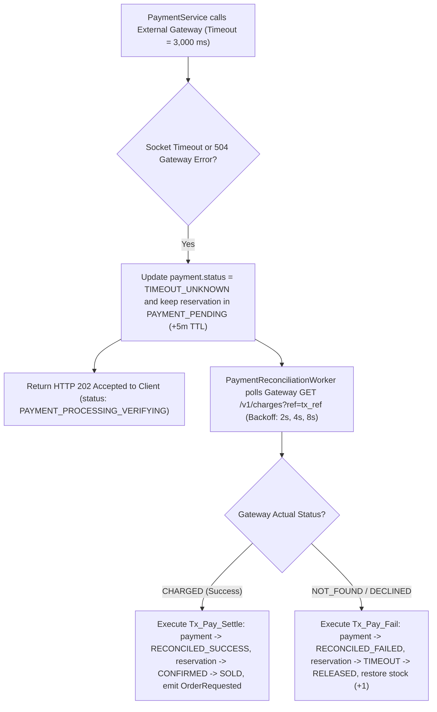
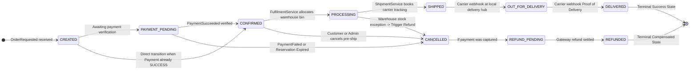

# Phase 4: Payment & Order Lifecycle Design
**Project:** SALESTORM — High-Concurrency Flash-Sale E-Commerce Platform  
**Event:** SYSCRAFTERS 2026 (Design-First System Design Hackathon)  
**Team:** Team 1  

---

## 1. Architectural Challenge: Distributed State Across Payment, Inventory & Order

Once a customer wins one of the 100 reservations (`RESERVED`), they proceed to payment (`POST /api/v1/payments`). At this boundary, SALESTORM solves five classic distributed-systems hazards:
1. **External Gateway Latency & Timeouts:** An external payment gateway (Stripe / Razorpay) takes 500–3,000 ms and can time out (`504 Gateway Timeout`), leaving the payment in an **unknown state** (`TIMEOUT_UNKNOWN`).
2. **Duplicate Payment Clicks:** Impatient users or flaky mobile networks retry `POST /api/v1/payments` with the same or different requests.
3. **Payment Rejection (5% Hackathon Benchmark):** When a card is declined, the reserved unit **must** be returned to `available_quantity` immediately so another waiting customer can buy it.
4. **Late Payment Arriving After Expiry (Race Guard `HIGH-01`):** Ensuring a stalled payment can never corrupt inventory counts or double-settle against `PaymentReconciliationWorker`.
5. **Payment Succeeds, Then `OrderService` Crashes for 30 Seconds (Mandatory Hackathon Scenario):** Even if `OrderService` is completely down for 30 seconds, zero paid orders may be lost.

---

## 2. Five Core Payment & Order Flows

### Flow 1: Happy Path — Payment Success $\rightarrow$ Atomic Outbox $\rightarrow$ Order Confirmed
1. **Pre-Charge Lock (`Tx_Pay_Init`):** `PaymentService` validates `Idempotency-Key`, verifies `inventory_reservation.status = 'RESERVED'` and `expires_at > NOW()`, transitions the reservation to `PAYMENT_PENDING` (extending `expires_at` by a 60s grace window), and inserts a `payment` row with `status = 'PENDING'` and a deterministic `transaction_reference` (`tx_ref_{reservation_id}`). Commits `Tx_Pay_Init` **before** making the network call.
2. **External Gateway Charge (Outside DB Tx):** `PaymentService` calls `IPaymentGatewayAdapter.charge()` wrapped in `CircuitBreakerProxy`, passing `idempotency_key = tx_ref_{reservation_id}` and a strict `3,000 ms` timeout.
3. **Atomic Settlement + Outbox Emission (`Tx_Pay_Settle`):** When the gateway returns `SUCCESS (provider_tx_id)`, `PaymentService` executes **one local ACID transaction** with strict conditional rowcount guards:
   * `UPDATE inventory_reservation SET status = 'CONFIRMED', updated_at = NOW() WHERE reservation_id = $1 AND status = 'PAYMENT_PENDING'` (**Assert `rowcount == 1`**; if `0`, the reservation was already settled or released $\rightarrow$ `ROLLBACK` and issue an automated Gateway Refund if `RELEASED`!)
   * `UPDATE inventory_reservation SET status = 'SOLD', version = version + 1, updated_at = NOW() WHERE reservation_id = $1 AND status = 'CONFIRMED'`
   * `UPDATE payment SET status = 'SUCCESS', provider_tx_id = $2, version = version + 1 WHERE payment_id = $3 AND status IN ('PENDING', 'TIMEOUT_UNKNOWN')`
   * `UPDATE inventory SET reserved_quantity = reserved_quantity - 1, sold_quantity = sold_quantity + 1, version = version + 1 WHERE product_id = $4`
   * `INSERT INTO outbox_event (event_id, aggregate_type, aggregate_id, event_type, payload, status) VALUES ($5, 'ORDER', $1, 'OrderRequested', $6, 'PENDING')`
4. **Async Order Creation:** `OutboxPublisherWorker` publishes `OrderRequested` to Kafka (`order.events`). `OrderService` consumes the event, inserts the `orders` row (`UNIQUE(reservation_id)`), transitions `CREATED` $\rightarrow$ `PAYMENT_PENDING` $\rightarrow$ `CONFIRMED`, and emits `OrderConfirmed`.

---

### Flow 2: Payment Failure (5% Card Decline) $\rightarrow$ Immediate Stock Release
1. `PaymentService` executes Step 1 (`Tx_Pay_Init`) and Step 2 (Gateway Call) as above.
2. Gateway returns an explicit terminal decline (`402 Payment Required / INSUFFICIENT_FUNDS`).
3. **Atomic Compensating Settlement (`Tx_Pay_Fail`):** In one local ACID transaction:
   * `UPDATE inventory_reservation SET status = 'PAYMENT_FAILED', updated_at = NOW() WHERE reservation_id = $1 AND status = 'PAYMENT_PENDING'` (**Assert `rowcount == 1`**)
   * `UPDATE inventory_reservation SET status = 'RELEASED', release_reason = 'PAYMENT_FAILED', version = version + 1 WHERE reservation_id = $1 AND status = 'PAYMENT_FAILED'`
   * `UPDATE payment SET status = 'FAILED', failure_reason = 'INSUFFICIENT_FUNDS', version = version + 1 WHERE payment_id = $2`
   * `UPDATE inventory SET reserved_quantity = reserved_quantity - 1, available_quantity = available_quantity + 1, version = version + 1 WHERE product_id = $3`
   * `INSERT INTO outbox_event (..., event_type = 'PaymentFailed')`
4. **Fast-Path Cache Restore & Key Cleanup:** Immediately after `Tx_Pay_Fail` commits, `PaymentService` runs `RedisLuaStockGate.releaseStock` (`INCRBY {product:PRODUCT_X}:stock 1` + `DEL {product:PRODUCT_X}:idem:{res_idem_key}` guarded by `SETNX release:{reservation_id}`) so the released unit is instantly available to the next customer in the flash sale!

---

### Flow 3: Gateway Network Timeout (`TIMEOUT_UNKNOWN`) & Active Reconciliation
**Hazard:** If the HTTP call to the payment gateway times out at `t = 3,000 ms`, **we must NOT immediately release the stock**, because the customer's card might actually have been charged at `t = 2,950 ms`!



---

### Flow 4: Duplicate Payment Prevention (Two-Layer Idempotency + Reservation Lock)
SALESTORM blocks duplicate charges across **three distinct vectors**:

| Duplicate Scenario | How Client Sends It | How SALESTORM Blocks It |
| :--- | :--- | :--- |
| **Vector A: Network Retry (Same `Idempotency-Key`)** | Client retries `POST /api/v1/payments` with identical `Idempotency-Key: pay-key-001`. | Fast-path lookup on `payment.idempotency_key` (backed by `UNIQUE(idempotency_key)` constraint). If `SUCCESS`, returns `200 OK` with the existing receipt. If `PENDING`, returns `409 Payment In Progress`. |
| **Vector B: Double-Click with Different `Idempotency-Key`s for Same `reservation_id`** | Buggy client generates `pay-key-001` and `pay-key-002` concurrently for `res_A`. | Step 1 (`Tx_Pay_Init`) executes `UPDATE inventory_reservation SET status = 'PAYMENT_PENDING' WHERE reservation_id = 'res_A' AND status = 'RESERVED'`. Only the first request gets `rowcount == 1`; the second sees `status = 'PAYMENT_PENDING'` (`rowcount == 0`) and is rejected **before calling the gateway**. Furthermore, `payment` enforces a partial unique index `UNIQUE(reservation_id) WHERE status IN ('PENDING', 'SUCCESS', 'RECONCILED_SUCCESS')`. |
| **Vector C: Gateway-Level Retry (Outbox/Reconciliation)** | `PaymentService` retries a timed-out HTTP request to Stripe/Razorpay. | Passes deterministic `transaction_reference = tx_ref_{reservation_id}` as the provider's `Idempotency-Key`, ensuring the external gateway itself never double-charges the card. |

---

### Flow 5: Payment Success Followed by `OrderService` Failure (30s Outage Recovery)

This is a **critical hackathon scenario**: Customer pays successfully at $t = 5\text{s}$, but `OrderService` crashes at $t = 4\text{s}$ and stays down for **30 seconds** (until $t = 34\text{s}$).

```mermaid
sequenceDiagram
    autonumber
    participant Cust as Customer
    participant Pay as PaymentService
    participant PG as PostgreSQL (Payment + Outbox)
    participant OutW as OutboxPublisherWorker
    participant CB as CircuitBreaker (OrderService)
    participant Ord as OrderService (DOWN 30s)
    participant DLQ as DeadLetterHandler

    Cust->>Pay: POST /api/v1/payments (Idempotency-Key: pay_101)
    Pay->>Pay: Charge External Gateway -> SUCCESS (prov_tx_99)
    Pay->>PG: BEGIN; UPDATE payment=SUCCESS; UPDATE reservation=CONFIRMED->SOLD; UPDATE inventory (res-1, sold+1); INSERT outbox_event (OrderRequested); COMMIT;
    Pay-->>Cust: 200 OK {"payment_status": "SUCCESS", "order_status": "CONFIRMING"}
    Note over Cust,PG: Customer payment and stock are 100% safely committed on disk

    rect rgb(255, 235, 235)
        Note over OutW,Ord: t = 5s to 35s: OrderService is DOWN (30-Second Outage)
        OutW->>PG: Poll PENDING outbox_event (batch=50, FOR UPDATE SKIP LOCKED)
        OutW->>CB: Dispatch OrderRequested (res_101)
        CB->>Ord: Deliver OrderRequested
        Ord--xCB: Connection Refused / 503 Service Unavailable (Failures 1..5)
        Note over CB: 5 consecutive failures -> Circuit Breaker trips OPEN (cooldown = 10s)
        CB-->>OutW: Fast-Fail CircuitBreakerOpenException
        OutW->>PG: UPDATE outbox_event SET retry_count = retry_count + 1, next_retry_at = NOW() + backoff
    end

    rect rgb(230, 255, 235)
        Note over OutW,Ord: t = 35s: OrderService Recovers
        OutW->>CB: Cooldown elapsed -> Circuit transitions to HALF_OPEN (1 probe request)
        CB->>Ord: Probe OrderRequested (res_101)
        Ord->>PG: BEGIN; INSERT INTO orders (UNIQUE reservation_id=res_101, status=CONFIRMED); COMMIT;
        Ord-->>CB: 201 Created (Probe Succeeded)
        Note over CB: Circuit transitions HALF_OPEN -> CLOSED
        OutW->>Ord: Drain all remaining buffered outbox_event rows
        OutW->>PG: UPDATE outbox_event SET status = PUBLISHED, processed_at = NOW()
    end

    alt Unrecoverable Poison Event (retry_count > MAX_RETRIES = 10)
        OutW->>PG: UPDATE outbox_event SET status = DEAD_LETTER
        OutW->>DLQ: Trigger Automated Compensation Saga
        DLQ->>Pay: Issue Gateway Refund (prov_tx_99) -> payment.status = REFUNDED
        DLQ->>PG: Restore inventory (sold - 1, available + 1) and notify customer
    end
```

---

## 3. Resilience Primitives Specification

| Primitive | Configuration in SALESTORM | Purpose |
| :--- | :--- | :--- |
| **`Idempotency-Key` Header** | UUIDv4 required on `POST /api/v1/reservations` and `POST /api/v1/payments`; TTL = `24 hours` in Redis, permanent `UNIQUE` index in PostgreSQL. | Prevents duplicate reservations and duplicate charges from client retries. |
| **`transaction_reference`** | Deterministic `tx_ref_{reservation_id}` stored in `payment` table (`UNIQUE`). | Passed to Stripe/Razorpay so gateway-side retries are strictly idempotent. |
| **Timeouts** | Gateway Connect Timeout = `500 ms`; Read Timeout = `2,500 ms` (Total = `3,000 ms`). Internal RPC Timeout = `1,000 ms`. | Bounds maximum thread/coroutine hold time; triggers `TIMEOUT_UNKNOWN` reconciliation. |
| **Retry with Exponential Backoff** | Max Retries = `10` for Outbox; Base Delay = `1s`, Multiplier = `2.0`, Max Delay = `30s`, Full Jitter. | Smoothly drains backlog after 30s `OrderService` outage without overwhelming recovery pods. |
| **3-State Circuit Breaker** | `failure_threshold = 5`, `recovery_timeout = 10s` (or `0.4s` in fast simulation), `half_open_max_calls = 2`. | Trips `OPEN` during downstream outages (`OrderService` or Payment Gateway), sheds load, and auto-heals via `HALF_OPEN` probe. |

---

## 4. Order Lifecycle & State Machine

### 4.1 Order State Diagram (`Mermaid`)



### 4.2 Explicit State Transition Matrix (Valid vs. Invalid Transitions)

To satisfy **Hackathon Scenario #6 (`test_invalid_state_transition_rejected`)**, `OrderStateMachine` enforces the following transition table. Any transition not marked ✅ throws `InvalidStateTransitionError` (`HTTP 422 Unprocessable Entity`):

| From State $\downarrow$ \ To State $\rightarrow$ | `PAYMENT_PENDING` | `CONFIRMED` | `PROCESSING` | `SHIPPED` | `OUT_FOR_DELIVERY` | `DELIVERED` | `CANCELLED` | `REFUND_PENDING` | `REFUNDED` |
| :--- | :---: | :---: | :---: | :---: | :---: | :---: | :---: | :---: | :---: |
| **`CREATED`** | ✅ | ✅ | ❌ | ❌ | ❌ | ❌ | ✅ | ❌ | ❌ |
| **`PAYMENT_PENDING`** | — | ✅ | ❌ | ❌ | ❌ | ❌ | ✅ | ❌ | ❌ |
| **`CONFIRMED`** | ❌ | — | ✅ | ❌ | ❌ | ❌ | ✅ | ✅ | ❌ |
| **`PROCESSING`** | ❌ | ❌ | — | ✅ | ❌ | ❌ | ✅ | ✅ | ❌ |
| **`SHIPPED`** | ❌ | ❌ | ❌ | — | ✅ | ❌ | ❌ | ❌ | ❌ |
| **`OUT_FOR_DELIVERY`** | ❌ | ❌ | ❌ | ❌ | — | ✅ | ❌ | ❌ | ❌ |
| **`DELIVERED`** *(Terminal)* | ❌ | ❌ | ❌ | ❌ | ❌ | — | ❌ | ❌ | ❌ |
| **`CANCELLED`** | ❌ | ❌ | ❌ | ❌ | ❌ | ❌ | — | ✅ | ❌ |
| **`REFUND_PENDING`** | ❌ | ❌ | ❌ | ❌ | ❌ | ❌ | ❌ | — | ✅ |
| **`REFUNDED`** *(Terminal)* | ❌ | ❌ | ❌ | ❌ | ❌ | ❌ | ❌ | ❌ | — |

---

## 5. Architectural Decisions for Phase 4 (Working Rule #3)

### Decision 4.1: Local ACID Outbox vs. Synchronous RPC for Payment-to-Order Handoff
* **Choice:** Commit `payment ('SUCCESS')`, `inventory ('SOLD')`, and `outbox_event ('OrderRequested')` in a single local PostgreSQL transaction, then deliver to `OrderService` asynchronously via `OutboxPublisherWorker` + Circuit Breaker.
* **Alternatives Rejected:**
  1. *Synchronous HTTP call from `PaymentService` to `OrderService` inside the `/api/v1/payments` request.*
  2. *Two-Phase Commit (XA Transaction) spanning Payment DB and Order DB.*
* **Why it fits SALESTORM:** Directly solves the mandatory **30-second `OrderService` outage** scenario. Even when `OrderService` is completely unreachable, customers who complete payment receive an immediate `200 OK` confirmation of payment, their unit is permanently marked `SOLD`, and `OutboxPublisherWorker` automatically creates the `CONFIRMED` order the moment `OrderService` recovers.
* **What it sacrifices:** Order creation is eventually consistent (typically $< 50\text{ ms}$ lag when healthy, or $30\text{s}$ lag during a $30\text{s}$ outage), requiring a `CONFIRMING` UI status badge for those few seconds.

### Decision 4.2: Pessimistic Hold (`TIMEOUT_UNKNOWN`) + Active Polling vs. Immediate Release on Gateway Timeout
* **Choice:** When the external payment gateway times out (`3,000 ms`), transition payment to `TIMEOUT_UNKNOWN`, hold the reservation in `PAYMENT_PENDING`, and resolve via `PaymentReconciliationWorker`.
* **Alternatives Rejected:**
  1. *Treat gateway timeout as immediate failure and release stock (`available + 1`) immediately.*
  2. *Auto-retry charging with a new transaction ID.*
* **Why it fits SALESTORM:** If a timeout occurred on the response path after the gateway already captured funds, releasing the stock immediately would allow a 101st customer to buy the unit—violating our **Zero Overselling** hard guarantee! Holding the unit for a few seconds while querying `GET /v1/charges?ref=tx_ref` guarantees we never oversell and never double-charge.
* **What it sacrifices:** Keeps 1 unit of inventory locked for an extra 2–30 seconds during rare gateway network timeouts.
