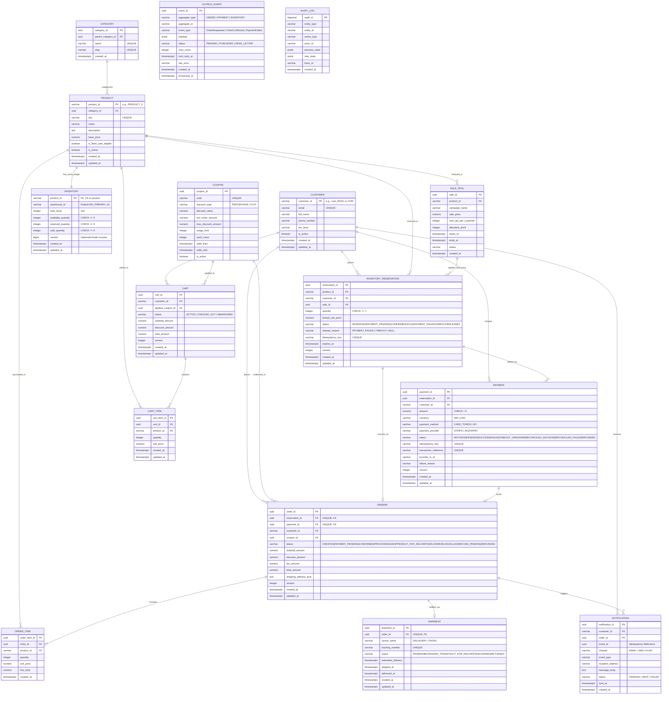

# Phase 7A: Database Architecture & Entity-Relationship Design
**Project:** SALESTORM — High-Concurrency Flash-Sale E-Commerce Platform  
**Event:** SYSCRAFTERS 2026 (Design-First System Design Hackathon)  
**Team:** Team 1  

---

## 1. Database Design Philosophy: Invariants Enforced at the Storage Engine

In SALESTORM, application code is **never the sole guardian of data correctness**. Even if an application pod had a bug, the PostgreSQL 16 database schema guarantees that **overselling, negative stock, duplicate reservations, duplicate charges, and duplicate orders are physically impossible to commit** via strict database-level constraints:

1. **Stock Conservation Invariant (`inventory` table):**
   * `CHECK (available_quantity >= 0)`
   * `CHECK (reserved_quantity >= 0)`
   * `CHECK (sold_quantity >= 0)`
   * `CHECK (available_quantity + reserved_quantity + sold_quantity = total_stock)`
2. **Idempotency & Deduplication Constraints:**
   * `inventory_reservation`: `UNIQUE (idempotency_key)`
   * `payment`: `UNIQUE (idempotency_key)`, `UNIQUE (transaction_reference)`, and partial unique index `UNIQUE (reservation_id) WHERE status IN ('PENDING', 'SUCCESS', 'RECONCILED_SUCCESS')`
   * `orders`: `UNIQUE (reservation_id)` and `UNIQUE (payment_id)`
   * `notification`: `UNIQUE (event_id, channel)` (idempotent notification delivery)

---

## 2. Complete Entity-Relationship (ER) Diagram (`Mermaid`)

Covers all **16 canonical tables** from Phase 1 across Customer, Catalog, Promotions, Cart, Inventory, Reservation, Payment, Order, Fulfilment/Shipment, Notification, Outbox, and Audit domains. Every key modifier uses single-token `PK` / `FK` syntax so it renders cleanly across all Mermaid versions.

### 2.1 Reference ER Layout Mapping Note
For judges comparing against the reference ER sheet (`SALESTORM - ER Diagram (Reference Layout).pdf`):
* `FlashSale` maps 1-to-1 to our **`SALE_DEAL`** table (`sale_id`, `product_id`, `starts_at`, `ends_at`, `sale_price`, `max_qty_per_customer`).
* `Warehouse` is represented by `inventory.warehouse_id` (and managed by `FulfilmentService`).
* `PaymentGateway` and `ShippingProvider` are modeled via pluggable strategy adapters (`IPaymentGatewayAdapter`, `IShippingPartnerAdapter`) with provider metadata persisted in `payment.payment_provider` and `shipment.carrier_name`.

---

## 3. Indexing & Hot-Row Optimization Strategy

| Table | Index Name & Columns | Index Type | Query Optimized |
| :--- | :--- | :--- | :--- |
| `inventory_reservation` | `idx_res_expiry_sweep (expires_at) WHERE status = 'RESERVED'` | **Partial B-Tree Index** | Allows `ExpirySweeperWorker` to find expired `RESERVED` holds in $O(\log K)$ without scanning millions of historical `SOLD` or `RELEASED` rows! |
| `payment` | `uq_payment_active_reservation (reservation_id) WHERE status IN ('PENDING', 'SUCCESS', 'RECONCILED_SUCCESS')` | **Partial Unique Index** | Guarantees a reservation can never have two active/successful payments simultaneously. |
| `payment` | `idx_payment_reconcile (created_at) WHERE status = 'TIMEOUT_UNKNOWN'` | **Partial B-Tree Index** | Allows `PaymentReconciliationWorker` to immediately locate timed-out gateway transactions needing status verification. |
| `outbox_event` | `idx_outbox_pending_poll (next_retry_at, created_at) WHERE status = 'PENDING'` | **Partial B-Tree Index** | Keeps `OutboxPublisherWorker` polling query (`FOR UPDATE SKIP LOCKED`) sub-millisecond even after millions of events are marked `PUBLISHED`. |
| `inventory` | `FILLFACTOR = 70` storage parameter on table | **PostgreSQL HOT (Heap-Only Tuple) Updates** | Leaves 30% free space on each 8KB data page so high-frequency `UPDATE inventory` statements write updated tuples on the **same page** without index bloat or page splits. |

---

## 4. Architectural Decisions for Phase 7 Database Design (Working Rule #3)

### Decision 7.1: Explicit Four-Column Stock Ledger (`total_stock`, `available_quantity`, `reserved_quantity`, `sold_quantity`) vs. `SUM()` Aggregation
* **Choice:** Maintain four explicit integer columns on `inventory` enforced by `CHECK (available_quantity + reserved_quantity + sold_quantity = total_stock)` and `CHECK (available_quantity >= 0)`.
* **Alternatives Rejected:**
  1. *Storing only `total_stock` and calculating available stock dynamically via `SELECT total_stock - COALESCE(SUM(quantity), 0) FROM inventory_reservation WHERE status IN ('RESERVED', 'SOLD')`.*
* **Why it fits SALESTORM:** Dynamic `SUM()` queries require scanning and locking multiple rows in `inventory_reservation` and cannot prevent concurrent inserts from exceeding 100 without `SERIALIZABLE` table locks. Our four-column ledger turns stock conservation into an $O(1)$ single-row conditional update verified instantaneously by the database engine.
* **What it sacrifices:** Requires every reservation state transition (`RESERVED` $\rightarrow$ `SOLD` or `RELEASED`) to update both `inventory_reservation` and `inventory` inside the same local ACID transaction.
