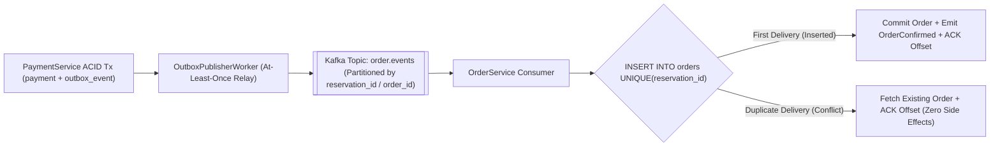

# Phase 7C: Domain Command & Event Catalogue
**Project:** SALESTORM — High-Concurrency Flash-Sale E-Commerce Platform  
**Event:** SYSCRAFTERS 2026 (Design-First System Design Hackathon)  
**Team:** Team 1  

---

## 1. Synchronous Commands vs. Asynchronous Domain Events

SALESTORM separates **Commands** (synchronous request-response actions expressing user intent) from **Domain Events** (immutable facts emitted via the `outbox_event` table and Apache Kafka after a state change has committed).

### 1.1 Command Catalogue (Synchronous API / RPC)

| Command Name | HTTP / Internal Endpoint | Issuer | Target Handler Service | Idempotency Mechanism | Failure / Rejection Codes |
| :--- | :--- | :--- | :--- | :--- | :--- |
| **`ReserveInventoryCommand`** | `POST /api/v1/reservations` | Customer Client / `CheckoutFacade` | `ReservationService` | Mandatory `Idempotency-Key` header + Redis Lua `{product:X}:idem:{key}` + DB `UNIQUE(idempotency_key)` | `400` Missing Header<br/>`409 SOLD_OUT` |
| **`ProcessPaymentCommand`** | `POST /api/v1/payments` | Customer Client / `CheckoutFacade` | `PaymentService` | Mandatory `Idempotency-Key` header + DB `UNIQUE(idempotency_key)` + Partial Unique Index on `reservation_id` | `402` Declined<br/>`409` Already Paid<br/>`410` Expired<br/>`202` Timeout Verifying |
| **`CreateOrderCommand`** *(Internal)* | `OrderService.createOrderFromOutbox()` | `OutboxPublisherWorker` | `OrderService` | `ON CONFLICT (reservation_id) DO NOTHING` (`UNIQUE(reservation_id)` on `orders` table) | `503` Service Down (triggers Circuit Breaker + Outbox retry) |
| **`AdvanceOrderStateCommand`** | `PATCH /api/v1/orders/{id}/transitions` | `FulfilmentService` / `ShipmentService` / Admin | `OrderService` | State check: if already in `target_status`, returns `200 OK` (idempotent no-op) | `422 INVALID_STATE_TRANSITION` |
| **`CompensateOrderCommand`** *(DLQ)* | `DeadLetterHandler.compensate()` | `OutboxPublisherWorker` (after 10 retries) | `PaymentService` & `InventoryService` | Gateway `refund(provider_tx_id)` is idempotent per charge ID | Logged to `audit_log` + PagerDuty P1 Alert |

---

## 2. Asynchronous Domain Event Catalogue (Kafka & Transactional Outbox)

Every domain event is persisted first to the `outbox_event` table inside the producer's local ACID transaction and published to Apache Kafka with an envelope containing `event_id` (UUID), `event_type`, `aggregate_id` (Kafka partition key), `occurred_at`, and `trace_id`.

| Event Name | Kafka Topic & Partition Key | Owner (Producer) Service | Consumer Service(s) | Exact Idempotent Consumption Mechanism |
| :--- | :--- | :--- | :--- | :--- |
| **`InventoryReserved`** | `inventory.events`<br/>Key: `product_id` | `ReservationService` | `StockReconciliationWorker`, `AuditLogSubscriber` | `AuditLogSubscriber` deduplicates on `event_id`; reconciliation compares absolute state snapshots. |
| **`ReservationExpired`** | `inventory.events`<br/>Key: `product_id` | `ExpirySweeperWorker` | `NotificationService`, `AuditLogSubscriber` | `UNIQUE (event_id, channel)` in `notification` table ensures user is notified at most once. |
| **`ReservationReleased`** | `inventory.events`<br/>Key: `product_id` | `PaymentService` / `ExpirySweeperWorker` | `EdgeCacheUpdater`, `StockReconciliationWorker` | Redis release Lua script checks `SETNX release:{reservation_id}` before executing `INCRBY` so stock is never restored twice! |
| **`PaymentInitiated`** | `payment.events`<br/>Key: `reservation_id` | `PaymentService` | `AuditLogSubscriber` | Append-only audit trail keyed by `(entity_id, event_id)`. |
| **`PaymentSucceeded`** | `payment.events`<br/>Key: `reservation_id` | `PaymentService` | `NotificationService`, `AuditLogSubscriber` | `UNIQUE (event_id, channel)` in `notification` prevents duplicate payment receipt emails. |
| **`PaymentFailed`** | `payment.events`<br/>Key: `reservation_id` | `PaymentService` | `NotificationService`, `AuditLogSubscriber` | `UNIQUE (event_id, channel)` in `notification` prevents duplicate payment failure alerts. |
| **`OrderRequested`** | `order.events`<br/>Key: `reservation_id` | `PaymentService` *(via `outbox_event`)* | `OrderService` | **Inbox Deduplication:** `INSERT INTO orders ... ON CONFLICT (reservation_id) DO NOTHING`. Even if `OutboxPublisherWorker` delivers `OrderRequested` 5 times, `orders` creates **exactly 1 row**. |
| **`OrderConfirmed`** | `order.events`<br/>Key: `order_id` | `OrderService` | `FulfilmentService`, `NotificationService` | `FulfilmentService` checks `WHERE order_id = $1 AND status = 'CONFIRMED'`; `NotificationService` checks `UNIQUE (event_id, channel)`. |
| **`OrderCancelled`** | `order.events`<br/>Key: `order_id` | `OrderService` | `PaymentService` *(Refund Saga)*, `NotificationService` | `PaymentService` checks `WHERE payment_id = $1 AND status != 'REFUNDED'` and passes deterministic refund key to gateway. |
| **`ShipmentDispatched`** | `shipment.events`<br/>Key: `order_id` | `ShipmentService` | `OrderService`, `NotificationService` | `OrderService` transitions `PROCESSING` $\rightarrow$ `SHIPPED` (no-op if already `SHIPPED`). |
| **`ShipmentDelivered`** | `shipment.events`<br/>Key: `order_id` | `ShipmentService` | `OrderService`, `NotificationService` | `OrderService` transitions `OUT_FOR_DELIVERY` $\rightarrow$ `DELIVERED` (terminal state). |

---

## 3. Canonical Event Envelope & Idempotent Consumer Flow

### 3.1 JSON Schema of an `OrderRequested` Outbox Event
```json
{
  "event_id": "e4d909c2-90d0-4899-9843-778899aabbcc",
  "event_type": "OrderRequested",
  "aggregate_type": "ORDER",
  "aggregate_id": "res_77112233-4455-6677-8899-aabbccddeeff",
  "occurred_at": "2026-10-12T09:15:02.412Z",
  "trace_id": "trc-4bf92f3577b34da6a3ce929d0e0e4736",
  "payload": {
    "reservation_id": "res_77112233-4455-6677-8899-aabbccddeeff",
    "payment_id": "pay_11223344-5566-7788-99aa-bbccddeeff00",
    "customer_id": "cust_00101",
    "product_id": "PRODUCT_X",
    "quantity": 1,
    "unit_price": 499.00,
    "total_amount": 499.00,
    "provider_tx_id": "ch_3Pq99123"
  }
}
```

### 3.2 How At-Least-Once Delivery + Idempotent Consumption Achieves "Effectively-Once" Semantics



### 3.3 Out-of-Order Event Protection
To guarantee that `ShipmentDelivered` is never processed before `ShipmentDispatched` (which would trigger `InvalidStateTransitionError` on `PROCESSING -> DELIVERED`), all order and shipment lifecycle events for a given order use **`order_id` as the Kafka Partition Key**, enforcing strict FIFO ordering within the partition. If an external webhook arrives out of sequence while the order is still in `PROCESSING`, the consumer NACKs with a short 2-second retry delay until the preceding `SHIPPED` transition commits.

---

## 4. Phase 7 Consistency Check with Phases 1–6
* **All 16 Tables Present:** `customer`, `category`, `product`, `inventory`, `sale_deal`, `coupon`, `cart`, `cart_item`, `inventory_reservation`, `payment`, `orders`, `order_item`, `shipment`, `notification`, `outbox_event`, `audit_log` match Phase 1's Canonical Domain Glossary 100%.
* **All States & Constraints Enforced:** Every `CHECK` constraint in `04_Database/schema.sql` matches the exact state enums in `05_API/openapi.yaml` and the state diagrams in Phases 3, 4, and 5.
