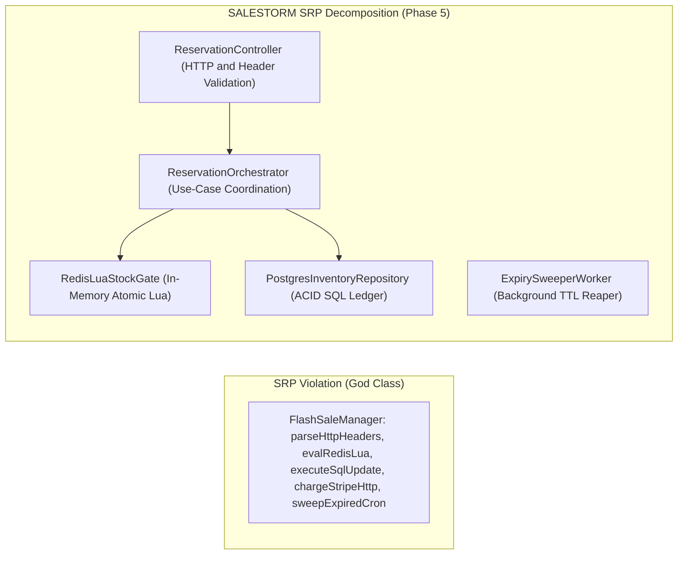
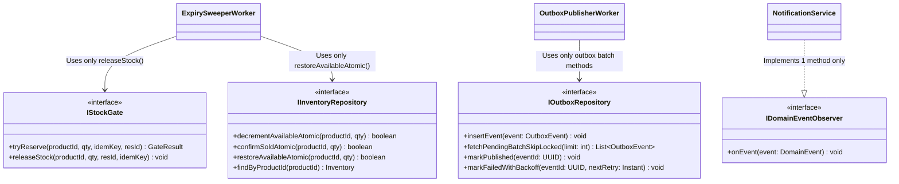
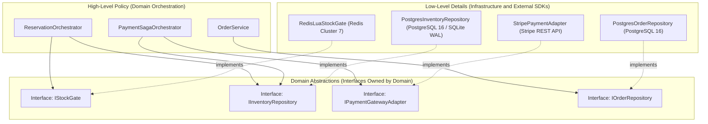

# Phase 6A: SOLID Principles Applied to SALESTORM
**Project:** SALESTORM — High-Concurrency Flash-Sale E-Commerce Platform  
**Event:** SYSCRAFTERS 2026 (Design-First System Design Hackathon)  
**Team:** Team 1  

---

## 1. Overview: Why SOLID Matters in a High-Concurrency Flash Sale

In a flash-sale architecture handling 10,000+ concurrent requests, coupling HTTP parsing, Redis Lua execution, SQL transactions, external gateway calls, and retry/circuit-breaker logic inside a single monolithic "God Service" makes concurrency bugs impossible to isolate and unit-test.

Below, each of the **five SOLID principles** is mapped directly to the real classes defined in **Phase 5 (`03_LLD/low_level_design.md`)**, showing the violation avoided, the exact class structure, and the architectural trade-off.

---

## 2. Principle-by-Principle Mapping to Phase 5 Classes

| SOLID Principle | Phase 5 Target Classes | Single Reason to Change / Contract Enforced | Violation Avoided |
| :--- | :--- | :--- | :--- |
| **S — Single Responsibility Principle (SRP)** | `ReservationController`, `RedisLuaStockGate`, `ReservationOrchestrator`, `PostgresInventoryRepository`, `ExpirySweeperWorker`, `OutboxPublisherWorker` | Each class has **exactly one axis of change** (HTTP protocol vs. Redis Lua gate vs. ACID transaction orchestration vs. SQL persistence vs. TTL sweeping). | Avoids a monolithic `FlashSaleService` where changing a SQL query risks breaking Redis Lua scripts or HTTP status codes. |
| **O — Open/Closed Principle (OCP)** | `IPaymentGatewayAdapter`, `IPricingStrategy`, `IShippingPartnerAdapter`, `IOrderState` | Open for extension (adding `PayPalPaymentAdapter`, `VipTierPricingStrategy`, `BlueDartShippingAdapter`) while **Closed for modification** of `PaymentSagaOrchestrator` or `CheckoutFacade`. | Avoids modifying tested core payment/checkout orchestration code with `if (provider == "STRIPE") ... else if (provider == "PAYPAL")` branches. |
| **L — Liskov Substitution Principle (LSP)** | `PostgresInventoryRepository` & `PessimisticInventoryRepository` implementing `IInventoryRepository`; all `IOrderState` implementations | Every subtype honors the exact post-conditions and invariants (`available_quantity >= 0`, return `true` iff 1 unit reserved, throw no unexpected checked exceptions) of its base interface. | Avoids a subtype that silently allows negative stock or returns `true` without persisting when substituted into `ReservationOrchestrator`. |
| **I — Interface Segregation Principle (ISP)** | `IStockGate`, `IInventoryRepository`, `IReservationRepository`, `IPaymentGatewayAdapter`, `IDomainEventObserver` | Clients depend only on narrow, role-specific interfaces (`ExpirySweeperWorker` only sees stock-restore methods, not payment charge methods). | Avoids a bloated `IDataStore` or `ICommerceService` interface forcing classes to implement dummy `throw UnsupportedOperationException()` methods. |
| **D — Dependency Inversion Principle (DIP)** | `ReservationOrchestrator` $\rightarrow$ `IStockGate`, `IInventoryRepository`; `PaymentSagaOrchestrator` $\rightarrow$ `IPaymentGatewayAdapter` | High-level domain orchestrators depend strictly on **domain abstractions (interfaces)**; low-level infrastructure (`RedisClusterClient`, `PostgreSQL`, `Stripe SDK`) depends on those same abstractions. | Avoids hardcoding `import redis` or `import stripe` inside business orchestrators, enabling fast in-memory unit testing of all 10k-concurrency scenarios. |

---

## 3. Deep-Dive on Each SOLID Principle

### 3.1 Single Responsibility Principle (SRP)
> *"A class should have one, and only one, reason to change."*

In the reservation and payment pipeline, we split responsibilities across six focused classes:
1. **`ReservationController`:** Changes **only** if the REST API contract (headers, JSON schema, HTTP status codes) changes.
2. **`RedisLuaStockGate`:** Changes **only** if the in-memory Redis Lua fast-path script or key naming changes.
3. **`ReservationOrchestrator`:** Changes **only** if the business steps of reserving an item change.
4. **`PostgresInventoryRepository`:** Changes **only** if the PostgreSQL table schema or conditional `UPDATE` SQL syntax changes.
5. **`ExpirySweeperWorker`:** Changes **only** if the background TTL batch-reclamation schedule or query changes.
6. **`OutboxPublisherWorker`:** Changes **only** if the outbox polling/CDC relay mechanism changes.

---

### 3.2 Open/Closed Principle (OCP)
> *"Software entities should be open for extension, but closed for modification."*

* **Where Applied:**
  1. **Payment Providers (`IPaymentGatewayAdapter`):** `PaymentSagaOrchestrator` calls `gatewayAdapter.charge(req)`. Adding `ApplePayAdapter` or `PayPalPaymentAdapter` requires creating **one new class** and registering it in `PaymentGatewayFactory`—zero lines of `PaymentSagaOrchestrator` change.
  2. **Flash-Sale Pricing (`IPricingStrategy`):** `CheckoutFacade` delegates price calculation to `IPricingStrategy` (`StandardPricingStrategy`, `FlashDealPricingStrategy`, `CouponPricingStrategy`, `LoyaltyTierPricingStrategy`). New promotional mechanics are added as new strategy classes without touching checkout logic.
  3. **Order Lifecycle (`IOrderState`):** Each state (`CreatedOrderState`, `PaymentPendingOrderState`, `ConfirmedOrderState`, `ProcessingOrderState`, `ShippedOrderState`, `OutForDeliveryOrderState`, `DeliveredOrderState`, `CancelledOrderState`, `RefundPendingOrderState`, `RefundedOrderState`) encapsulates its own legal outbound transitions.

---

### 3.3 Liskov Substitution Principle (LSP)
> *"Subtypes must be substitutable for their base types without altering any desirable correctness properties (invariants) of the program."*

* **Where Applied (`IInventoryRepository` Contract):**
  Both `PostgresInventoryRepository` (Atomic Conditional Update: `UPDATE ... WHERE available_quantity >= :qty`) and `PessimisticInventoryRepository` (`SELECT ... FOR UPDATE` row lock) implement `IInventoryRepository.decrementAvailableAtomic(productId, qty)`.
* **Behavioral Contract Guaranteed by All Subtypes:**
  * **Pre-condition:** `qty >= 1` and `productId` exists.
  * **Post-condition 1:** Returns `true` if and only if `available_quantity` was $\ge \text{qty}$ and was decremented by `qty` while `reserved_quantity` was incremented by `qty`.
  * **Post-condition 2:** Returns `false` (never throws a generic SQL exception) when `available_quantity < qty`.
  * **Invariant Preserved:** `available_quantity + reserved_quantity + sold_quantity == total_stock` and `available_quantity >= 0`.
* Because both implementations strictly honor this contract, `ReservationOrchestrator` swaps between `atomic` and `pessimistic` strategies at runtime (`INVENTORY_STRATEGY` env var in Phase 10 simulation) with **100% identical correctness test results**.

---

### 3.4 Interface Segregation Principle (ISP)
> *"Clients should not be forced to depend upon interfaces that they do not use."*

Instead of a single monolithic `IInventoryAndOrderStore` interface with 25 methods, SALESTORM segregates persistence and infrastructure contracts by role:

* `NotificationService` only implements `IDomainEventObserver.onEvent(DomainEvent)`—it has zero dependency on database repositories or payment gateways.
* `OutboxPublisherWorker` depends only on `IOutboxRepository`, never on `IInventoryRepository`.

---

### 3.5 Dependency Inversion Principle (DIP)
> *"High-level modules should not depend on low-level modules. Both should depend on abstractions."*

---

## 4. Architectural Trade-Off Decision for SOLID (Working Rule #3)

* **Choice:** Enforce strict interface boundaries (`IStockGate`, `IInventoryRepository`, `IPaymentGatewayAdapter`, `IOrderState`, `IDomainEventObserver`) and constructor dependency injection across all core services.
* **Alternatives Rejected:**
  1. *Direct static/singleton calls to Redis, SQL queries, and Stripe SDK methods inside FastAPI/Spring controller routes.*
* **Why it fits SALESTORM:** Enables deterministic testing of every failure mode required by the jury—such as injecting a `FaultyPaymentGatewayAdapter` (5% failure rate), toggling `OrderService` down for 30 seconds, or benchmarking `PostgresInventoryRepository` vs. `PessimisticInventoryRepository`—without modifying a single line of business orchestration code.
* **What it sacrifices:** Slightly higher file/class count (interface + implementation pairs) compared to inline script code, which we keep manageable by restricting interfaces to genuine variation points.
