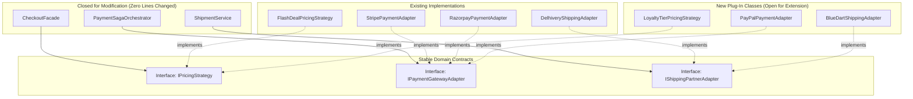

# Phase 6B: Design Patterns & Extensibility Blueprints
**Project:** SALESTORM — High-Concurrency Flash-Sale E-Commerce Platform  
**Event:** SYSCRAFTERS 2026 (Design-First System Design Hackathon)  
**Team:** Team 1  

---

## 1. Master Summary of the 8 Core Design Patterns in SALESTORM

Every pattern below is used to solve a **specific distributed-systems or domain-complexity problem** in SALESTORM—never for artificial complexity. Each entry follows Working Rule #3 (Choice/Pattern, Problem Solved, Alternatives Rejected, Where Used in Phase 5, and What It Sacrifices).

| # | Pattern | Category | Where Used in Phase 5 LLD | Problem Solved | What It Sacrifices (Trade-Off) |
| :--- | :--- | :--- | :--- | :--- | :--- |
| **1** | **Strategy** | Behavioral | `IPricingStrategy` (`FlashDealPricingStrategy`, `CouponPricingStrategy`); `IInventoryRepository` (`PostgresInventoryRepository` vs `PessimisticInventoryRepository`) | Swaps algorithms (pricing rules or concurrency locking mechanisms) at runtime without changing callers. | Indirection across strategy classes; caller must know or receive the configured strategy. |
| **2** | **Factory** | Creational | `PaymentGatewayFactory`, `ShippingPartnerFactory`, `OrderStateFactory` | Centralizes instantiation of provider adapters (`STRIPE`, `RAZORPAY`, `DELHIVERY`, `FEDEX`) based on config/request payload. | Adds factory maintenance when new constructor dependencies are introduced to adapters. |
| **3** | **State** | Behavioral | `IOrderState` (`CreatedOrderState`, `PaymentPendingOrderState`, `ConfirmedOrderState`, `ProcessingOrderState`, `ShippedOrderState`, `OutForDeliveryOrderState`, `DeliveredOrderState`, `CancelledOrderState`, `RefundPendingOrderState`, `RefundedOrderState`) | Enforces valid Order lifecycle transitions (`CREATED` $\rightarrow$ ... $\rightarrow$ `DELIVERED`) and rejects invalid jumps (`InvalidStateTransitionError`). | Creates one class per state (10 classes) instead of a compact transition lookup map. |
| **4** | **Observer (Pub/Sub)** | Behavioral | `IDomainEventObserver` implemented by `NotificationService`, `FulfilmentService`, `AuditLogSubscriber` (backed by Kafka in prod) | Decouples `OrderService` and `PaymentService` from side effects (emails, SMS, warehouse pick-pack, audit logging). | Eventual consistency; harder to trace execution flow without distributed correlation IDs (`trace_id`). |
| **5** | **Adapter** | Structural | `IPaymentGatewayAdapter` (`StripePaymentAdapter`, `RazorpayPaymentAdapter`); `IShippingPartnerAdapter` (`DelhiveryShippingAdapter`, `FedExShippingAdapter`) | Translates incompatible third-party SDK schemas/exceptions into SALESTORM's canonical domain objects (`GatewayChargeResponse`). | Requires maintaining translation mapping code whenever external vendor APIs version-bump. |
| **6** | **Facade** | Structural | `CheckoutFacade` (`evaluateCartPrice()`, `reserveItem()`, `executePayment()`) | Shields API controllers and clients from the complex multi-step coordination across `CartService`, `IPricingStrategy`, `ReservationOrchestrator`, and `PaymentSagaOrchestrator`. | Can risk becoming a "God Facade" if business logic creeps out of orchestrators into the facade. |
| **7** | **Repository** | Enterprise / Data | `IInventoryRepository`, `IReservationRepository`, `IPaymentRepository`, `IOrderRepository`, `IOutboxRepository` | Encapsulates complex SQL (`FOR UPDATE SKIP LOCKED`, conditional atomic `UPDATE ... WHERE available >= 1`) behind clean domain collection interfaces. | Leaky abstractions can occur if callers need fine-grained transaction control across multiple repositories (solved via `UnitOfWork / TransactionManager`). |
| **8** | **Circuit Breaker** | Resilience / Stability | `CircuitBreakerProxy` wrapping `IPaymentGatewayAdapter` and `OrderService` (`CLOSED` $\rightarrow$ `OPEN` $\rightarrow$ `HALF_OPEN`) | Prevents cascading thread-pool exhaustion during the mandatory **30-second `OrderService` outage** or payment gateway brownouts by failing fast when `OPEN`. | Tuning thresholds (`failure_threshold = 5`, `recovery_timeout = 10s`) requires care to avoid false-positive trips on transient blips. |

---

## 2. Detailed Breakdown of Each Pattern (Working Rule #3)

### 2.1 Pattern 1: Strategy Pattern (`IPricingStrategy` & Concurrency Strategy)
* **Problem Solved:** Flash sales combine multiple discount mechanisms (flat flash-sale deal price, percentage off, tiered VIP discounts, coupon codes), and our benchmark requires comparing **Atomic Conditional Update** vs. **Pessimistic Row Locking** under 10,000 requests.
* **Alternatives Rejected:** Hardcoding `if/else` branches inside `CheckoutFacade` or `ReservationOrchestrator`.
* **Where Used:**
  * `IPricingStrategy.calculatePrice(basePrice, deal, customer)` with concrete strategies `FlashDealPricingStrategy`, `CouponPricingStrategy`, and `LoyaltyTierPricingStrategy`.
  * `IInventoryRepository` with `PostgresInventoryRepository` (Atomic SQL) and `PessimisticInventoryRepository` (`SELECT ... FOR UPDATE`).
* **Trade-Off:** Requires dependency injection wiring to select the active strategy per request or environment.

### 2.2 Pattern 2: Factory Pattern (`PaymentGatewayFactory` & `ShippingPartnerFactory`)
* **Problem Solved:** A customer may pay via Stripe (Cards), Razorpay (UPI), or PayPal, and their shipment may be routed to Delhivery or FedEx depending on destination pincode.
* **Alternatives Rejected:** Instantiating concrete adapters with `new StripePaymentAdapter(...)` inside `PaymentSagaOrchestrator`.
* **Where Used:** `PaymentGatewayFactory.getAdapter(paymentMethodOrProvider)` returns the matching `IPaymentGatewayAdapter` singleton from an injected registry map.
* **Trade-Off:** All registered adapters must adhere to the same `IPaymentGatewayAdapter` interface signature.

### 2.3 Pattern 3: State Pattern (`IOrderState` & `Order`)
* **Problem Solved:** Orders have 10 possible statuses (`CREATED`, `PAYMENT_PENDING`, `CONFIRMED`, `PROCESSING`, `SHIPPED`, `OUT_FOR_DELIVERY`, `DELIVERED`, `CANCELLED`, `REFUND_PENDING`, `REFUNDED`). Scattered status updates allow illegal transitions (e.g., jumping from `CREATED` straight to `DELIVERED`, or cancelling an already `DELIVERED` order).
* **Alternatives Rejected:** Unchecked `order.setStatus(...)` setters or deeply nested `switch(order.status)` statements.
* **Where Used:** `Order.transitionTo(targetStatus)` delegates to `currentState.transition(this, targetStatus)`. If `canTransitionTo(targetStatus)` is `false`, it raises `InvalidStateTransitionError`.
* **Trade-Off:** Introduces a family of 10 state classes (`CreatedOrderState`, `PaymentPendingOrderState`, `ConfirmedOrderState`, etc.), traded off for 100% compile-time and runtime state safety.

### 2.4 Pattern 4: Observer Pattern (`IDomainEventObserver` & Event Bus / Kafka)
* **Problem Solved:** When an order transitions to `CONFIRMED`, four things must happen: send confirmation email/SMS, allocate warehouse fulfilment, update analytics metrics, and write an audit log. Doing all four synchronously inside `OrderService` slows down order creation and couples `OrderService` to external SMTP/SMS failures.
* **Alternatives Rejected:** Direct synchronous calls from `OrderService` to `NotificationService.sendEmail()` and `FulfilmentService.allocate()`.
* **Where Used:** `OrderService` publishes `OrderConfirmed` to registered `IDomainEventObserver` listeners (in-memory event bus for local/simulation; Apache Kafka consumer groups in production).
* **Trade-Off:** Observers process asynchronously, so consumers must be idempotent (`UNIQUE(event_id)` in `notification` table).

### 2.5 Pattern 5: Adapter Pattern (`IPaymentGatewayAdapter` & `IShippingPartnerAdapter`)
* **Problem Solved:** Stripe returns `PaymentIntent` objects with HTTP 402/429 codes; Razorpay returns `order_id/payment_id` JSON payloads with HMAC signatures; Delhivery uses XML/JSON waybill payloads.
* **Alternatives Rejected:** Letting Stripe or Razorpay SDK types leak into `PaymentSagaOrchestrator` and the `payment` database schema.
* **Where Used:** `StripePaymentAdapter` and `RazorpayPaymentAdapter` implement `IPaymentGatewayAdapter`, translating vendor responses into SALESTORM's canonical `GatewayChargeResponse(status, providerTxId, errorCode)`.
* **Trade-Off:** Extra DTO mapping step per external call ($< 0.01\text{ ms}$ overhead).

### 2.6 Pattern 6: Facade Pattern (`CheckoutFacade`)
* **Problem Solved:** A flash-sale purchase spans authentication context extraction, pricing/coupon evaluation, fast-path inventory reservation, and idempotent payment execution.
* **Alternatives Rejected:** Making mobile/web clients or API controllers orchestrate 4 microservices in sequence.
* **Where Used:** `CheckoutFacade` exposes clean entry points (`evaluateCartPrice`, `reserveItem`, and `executePayment`) that coordinate `IPricingStrategy`, `ReservationOrchestrator`, and `PaymentSagaOrchestrator`.
* **Trade-Off:** Must remain a thin coordinator without absorbing domain logic.

### 2.7 Pattern 7: Repository Pattern (`IInventoryRepository`, `IOutboxRepository`, etc.)
* **Problem Solved:** High-concurrency SQL queries (such as `UPDATE inventory ... WHERE available_quantity >= 1`, `FOR UPDATE SKIP LOCKED` in outbox/expiry workers, and `ON CONFLICT (reservation_id) DO NOTHING`) are intricate and database-specific.
* **Alternatives Rejected:** Writing raw SQL strings inside `ReservationOrchestrator`, `PaymentSagaOrchestrator`, and `ExpirySweeperWorker`.
* **Where Used:** `PostgresInventoryRepository`, `PostgresReservationRepository`, `PostgresPaymentRepository`, `PostgresOrderRepository`, `PostgresOutboxRepository`.
* **Trade-Off:** Requires clear transaction boundary management (`TransactionManager`) when a single ACID transaction spans multiple repositories (as in `Tx_Pay_Settle`).

### 2.8 Pattern 8: Circuit Breaker Pattern (`CircuitBreakerProxy`)
* **Problem Solved:** During the **30-second `OrderService` outage** (or an external payment gateway outage), continuing to send requests causes threads to hang until timeout, exhausting connection pools and crashing the entire platform.
* **Alternatives Rejected:** Simple retry loops without circuit breaking (which amplify load on a failing dependency).
* **Where Used:** `CircuitBreakerProxy` wraps both `IPaymentGatewayAdapter.charge()` and `OutboxPublisherWorker` $\rightarrow$ `OrderService.createOrderFromOutbox()`. After `5` consecutive failures, it trips `OPEN` for `10s`, failing fast in memory, then allows `1` probe call in `HALF_OPEN` before resetting to `CLOSED`.
* **Trade-Off:** While `OPEN`, requests fail fast (`503` or buffered in Outbox) for the remainder of the cooldown window (`10s`) even if the downstream service recovers at second `8`.

---

## 3. Extensibility Proofs: Zero-Touch Addition of New Providers & Rules

A key jury evaluation criterion is: **"How easily can Team 1 add a new payment provider, pricing strategy, or delivery partner without breaking existing flash-sale logic?"**



### 3.1 How to Add a New Payment Provider (e.g., `PayPalPaymentAdapter`)
1. **Create 1 New Class:** Implement `IPaymentGatewayAdapter`:
   ```python
   class PayPalPaymentAdapter(IPaymentGatewayAdapter):
       def charge(self, req: GatewayChargeRequest) -> GatewayChargeResponse:
           # Translate GatewayChargeRequest -> PayPal Orders v2 API with PayPal-Request-Id = req.transaction_reference
           ...
       def refund(self, provider_tx_id: str, amount: Decimal) -> GatewayRefundResponse:
           ...
       def get_charge_status(self, transaction_reference: str) -> GatewayStatusResponse:
           ...
   ```
2. **Register in Factory Registry:** Add `"PAYPAL": PayPalPaymentAdapter()` to `PaymentGatewayFactory._registry`.
3. **Files Modified in Core Domain (`PaymentSagaOrchestrator`, `CircuitBreakerProxy`, `OutboxRepository`):** **0 files modified.** Idempotency, Circuit Breaker protection, `TIMEOUT_UNKNOWN` reconciliation, and Outbox emission work automatically for PayPal!

### 3.2 How to Add a New Pricing Strategy (e.g., `LoyaltyTierPricingStrategy`)
1. **Create 1 New Class:** Implement `IPricingStrategy`:
   ```python
   class LoyaltyTierPricingStrategy(IPricingStrategy):
       def calculate_price(self, base_price: Decimal, deal: Optional[SaleDeal], customer: Customer) -> Decimal:
           flash_price = deal.sale_price if deal else base_price
           return flash_price * Decimal("0.95") if customer.tier == "PLATINUM" else flash_price
   ```
2. **Inject via Config/Factory:** Bind `LoyaltyTierPricingStrategy` in `PricingStrategyFactory` for loyalty flash sales.
3. **Files Modified in `CheckoutFacade` / `CartService`:** **0 files modified.**

### 3.3 How to Add a New Delivery Partner (e.g., `BlueDartShippingAdapter`)
1. **Create 1 New Class:** Implement `IShippingPartnerAdapter`:
   ```python
   class BlueDartShippingAdapter(IShippingPartnerAdapter):
       def book_shipment(self, order: Order, address: Address) -> ShipmentBookingResult:
           # Call BlueDart Waybill API and return canonical tracking_number + carrier="BLUEDART"
           ...
   ```
2. **Register in `ShippingPartnerFactory`:** Add pincode/routing rule for `"BLUEDART"`.
3. **Files Modified in `ShipmentService` / `OrderService`:** **0 files modified.**

---

## 4. Phase 6 Consistency Check with Phases 1–5
* Every interface and class referenced in `06_SOLID/solid_principles.md` and `07_Design_Patterns/design_patterns.md` (`CheckoutFacade`, `ReservationOrchestrator`, `PaymentSagaOrchestrator`, `RedisLuaStockGate`, `PostgresInventoryRepository`, `PessimisticInventoryRepository`, `IPaymentGatewayAdapter`, `CircuitBreakerProxy`, `IOrderState`, `IDomainEventObserver`) matches the exact names in Phase 5 (`03_LLD/low_level_design.md` and `03_LLD/class_diagram.puml`).
