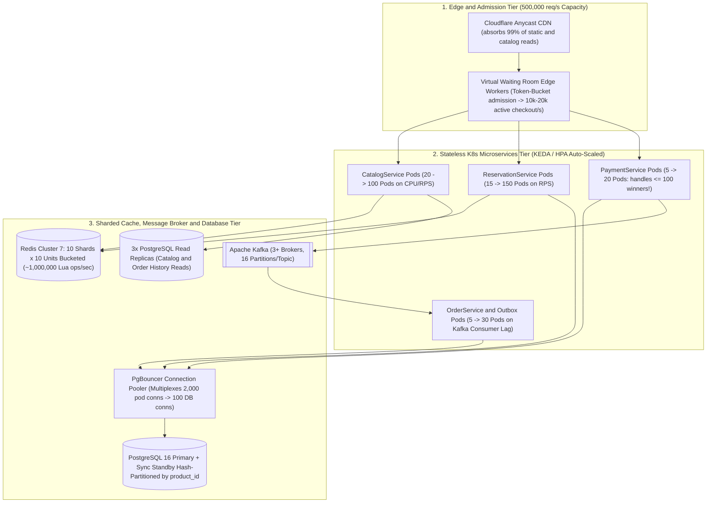

# Phase 8A: Scalability, Reliability & Fault-Tolerance Architecture
**Project:** SALESTORM — High-Concurrency Flash-Sale E-Commerce Platform  
**Event:** SYSCRAFTERS 2026 (Design-First System Design Hackathon)  
**Team:** Team 1  

---

## 1. Horizontal Scaling Strategy (10,000 req/s Baseline $\rightarrow$ 500,000 req/s Flash Peak)

SALESTORM scales each tier independently according to its specific workload profile (Read-Heavy vs. Contention-Heavy vs. I/O-Wait-Heavy):

### 1.1 Tier-by-Tier Scaling Matrix

| Service / Component | Baseline (10k RPS) | 50× Flash Peak (500k RPS) | Scaling Trigger (HPA / KEDA) | Why It Scales Linearly |
| :--- | :--- | :--- | :--- | :--- |
| **`CatalogService`** | 10 Pods | 80 Pods (+ CDN Edge Cache) | CPU $> 60\%$ or RPS $> 1,000/\text{pod}$ | 100% stateless; 99% of requests hit Cloudflare CDN (TTL `5s` for stock badge, `300s` for metadata) or Redis Cache-Aside. |
| **`ReservationService`** | 10 Pods | 150 Pods (Pre-warmed 5m before sale) | Incoming HTTP RPS & Virtual Waiting Room queue depth | Stateless pods; executes non-blocking Redis Lua `EVALSHA` ($< 0.1\text{ ms}$). Only the 100 winners ever open a DB transaction. |
| **`PaymentService`** | 4 Pods | 10 Pods | Active `RESERVED` count | **Crucial Insight:** Even at 500,000 req/s, only $\le 100$ customers win a reservation! `PaymentService` never sees more than $\sim 100$ requests per flash sale. |
| **`OrderService` & Workers** | 4 Pods | 16 Pods | Kafka Consumer Group Lag on `order.events` | Partitioned by `reservation_id` across 16 partitions; scales horizontally up to 16 parallel consumer pods. |

### 1.2 10-Bucket Redis Inventory Sharding with Ring Fallback (`MED-05`)
To prevent a single Redis shard from becoming a hot-key bottleneck at `500,000 req/s`:
1. The 100 units of `PRODUCT_X` are pre-warmed across **10 independent Redis hash-slot buckets** (`{product:PRODUCT_X:b0}:stock = 10` through `{product:PRODUCT_X:b9}:stock = 10`).
2. `ReservationService` hashes `bucket = crc32(customer_id) % 10` and executes `tryReserve` on bucket `b`.
3. **Zero Stranded Stock (Fallback Ring Probe):** If bucket `b` returns `SOLD_OUT (0)` while the global `edge:sold_out:PRODUCT_X` flag is still `false`, `ReservationService` probes `(bucket + i) % 10` for `i = 1..9` before returning `409 SOLD_OUT`. Only when all 10 buckets reach `0` is `edge:sold_out:PRODUCT_X = true` broadcast.

---

## 2. Multi-Layer Caching Strategy

SALESTORM uses three distinct caching patterns matched to the consistency requirements of each domain:

| Data Domain | Cache Pattern | TTL & Eviction | Invalidation / Synchronization Mechanism |
| :--- | :--- | :--- | :--- |
| **1. Product Catalog & Sale Rules (`product`, `sale_deal`)** | **Cache-Aside + CDN Edge Caching** | CDN: `60s`; Redis: `300s` | On admin price/deal update, `CatalogService` writes to PostgreSQL and publishes a `CacheInvalidate(product_id)` event to purge Redis & CDN keys. |
| **2. Flash-Sale Inventory Gate (`{product:PRODUCT_X}:stock`)** | **Write-Through Atomic Gate (Redis Lua + DB Ledger)** | Pinned in memory (`NOEVICTION` policy on stock shard) | Pre-warmed from `inventory.available_quantity` 5 minutes before sale start. Decremented atomically via Lua; incremented on payment failure or TTL expiry (while deleting `KEYS[3]` idempotency key); verified every `5s` by `StockReconciliationWorker` (healing only persistent drift $> 10\text{s}$). |
| **3. Sold-Out Fast Flag (`edge:sold_out:PRODUCT_X`)** | **Broadcast Short-Circuit Cache (API Gateway / Edge memory)** | `1 second` local memory TTL | Set to `true` the millisecond Redis stock hits `0`. Allows API Gateway pods to reject 490,000+ req/s locally in $< 0.05\text{ ms}$ without even a Redis network hop! Automatically clears if `ExpirySweeperWorker` restores stock. |

---

## 3. Queueing & Event Streaming Architecture

1. **Edge Queueing (Virtual Waiting Room):** Protects the synchronous entry point during 50× spikes (`500,000 req/s`). Uses an edge token bucket to admit a steady stream of requests (`10,000–20,000 req/s`) to the origin API Gateway while showing waiting users a real-time position counter.
2. **Core Transaction Decoupling (Transactional Outbox + Kafka):**
   * **Topics:** `order.events` (16 partitions), `payment.events` (16 partitions), `inventory.events` (8 partitions), `notification.events` (16 partitions), and `order.dlq` (4 partitions).
   * **Broker Durability Guarantees:** Configured with `acks = all`, `replication.factor = 3`, and `min.insync.replicas = 2`. No published event is lost even if an entire Availability Zone goes offline.

---

## 4. Database Scaling Strategy (Read Replicas, Pooling & Partitioning)

1. **Read/Write Split (`Primary` vs. `Read Replicas`):**
   * **100% of writes** (`POST /api/v1/reservations`, `POST /api/v1/payments`, `OrderService` creation, `ExpirySweeperWorker`) route through **PgBouncer** (in `transaction` pooling mode) to **PostgreSQL 16 Primary**.
   * **100% of read queries** (catalog cache misses, customer order history `GET /api/v1/orders`, analytics) route to **3 Asynchronous Read Replicas**.
2. **Synchronous Standby for Zero Data Loss (`RPO = 0`):**
   * PostgreSQL Primary uses `synchronous_commit = on` with `synchronous_standby_names = 'FIRST 1 (az2_standby)'`. A payment or reservation transaction is never acknowledged as committed until its WAL record is safely flushed to disk in **both AZ-1 and AZ-2**.
3. **Horizontal Partitioning (Sharding) for Multi-Product Flash Sales:**
   * `inventory` and `inventory_reservation` are hash-partitioned by `product_id` (`PARTITION BY HASH (product_id)` across 16 partitions / Citus shards) so concurrent flash sales for `PRODUCT_X`, `PRODUCT_Y`, and `PRODUCT_Z` never contend on the same B-tree index or buffer pages.
   * `orders` and `audit_log` are range-partitioned monthly by `created_at` (`PARTITION BY RANGE (created_at)`) to keep working-set indexes compact in RAM.

---

## 5. Failure Handling, Outage Recovery & Graceful Degradation Matrix

The jury tests how SALESTORM survives **four major infrastructure outages**:

```mermaid
flowchart TD
    subgraph F1["Outage 1: Redis Cluster Shard Crash or Restart"]
        R_FAIL["Redis Master AZ-1 Fails or Restarts Empty"] --> R_PROM["Redis Sentinel/Cluster promotes AZ-2 Replica (<5s)"]
        R_FAIL --> R_FALL["Fallback: Lua returns -1 CACHE_MISS -> Single-Flight DB Seed OR direct PostgreSQL Conditional UPDATE (WHERE available >= 1)"]
    end

    subgraph F2["Outage 2: PostgreSQL Primary Crash"]
        PG_FAIL["PG Primary AZ-1 Fails"] --> PG_PROM["Patroni/RDS promotes Sync Standby in AZ-2 (RTO < 30s, RPO = 0)"]
        PG_PROM --> PG_HOLD["In-flight reservations retry safely via client Idempotency-Key"]
    end

    subgraph F3["Outage 3: External Payment Gateway Outage / Brownout"]
        GW_FAIL["Stripe/Razorpay 5xx or Timeouts > 3,000ms"] --> GW_CB["CircuitBreakerProxy trips OPEN after 5 failures"]
        GW_CB --> GW_FO["PaymentGatewayFactory auto-routes new charges to Secondary Provider OR holds reservation (+5m TTL) for PaymentReconciliationWorker"]
    end

    subgraph F4["Outage 4: OrderService Down for 30 Seconds"]
        ORD_FAIL["OrderService Pods Unreachable (30s)"] --> ORD_CB["Outbox CircuitBreaker trips OPEN; Outbox events stay safely in PostgreSQL outbox_event"]
        ORD_CB --> ORD_REC["After 30s: HALF_OPEN probe succeeds -> Circuit CLOSED -> Backlog drained in <3s"]
    end
```

### 5.1 Detailed Failure & Graceful Degradation Playbook

| Failure Scenario | Immediate System Behavior | Data Integrity Guarantee | Graceful Degradation UX Shown to Customer |
| :--- | :--- | :--- | :--- |
| **1. Redis Fast-Path Cache Down or Restarted Empty (`HIGH-03`)** | If Redis is unreachable, `RedisLuaStockGate` catches `RedisConnectionException` and falls back to `PostgresInventoryRepository.decrementAvailableAtomic()` (`WHERE available_quantity >= 1`) while API Gateway tightens rate limits. If Redis restarts with an empty key (`GET` returns `nil`), the Lua script returns `{-1, "CACHE_MISS"}` (never false `SOLD_OUT`) and triggers a single-flight lock (`SETNX {product:X}:init_lock`) to re-seed `{product:X}:stock` from PostgreSQL `available_quantity`. | **Zero Overselling & Zero False Sold-Out:** PostgreSQL `CHECK (available_quantity >= 0)` is the authoritative source of truth. | Slightly higher reservation latency (`p99 ~120ms` instead of `15ms`), zero failed valid purchases. |
| **2. PostgreSQL Primary Crash** | Patroni/RDS triggers automatic failover to the **Synchronous Standby in AZ-2** within `< 20–30 seconds`. Because `synchronous_commit = on`, **zero committed reservations or payments are lost (`RPO = 0`)**. | **Zero Lost Ledger Records:** Client retries during the 20s failover window carry the same `Idempotency-Key` and resume cleanly. | Brief `"Reconnecting — Your spot is protected"` retry spinner on mobile/web client. |
| **3. External Payment Gateway Outage** | If timeouts hit `3,000 ms`, payment enters `TIMEOUT_UNKNOWN` (`202 Accepted`) and `ExpirySweeperWorker` ignores `PAYMENT_PENDING` rows while `PaymentReconciliationWorker` extends `expires_at + 5m` and polls the gateway. If 5 consecutive 5xx errors occur, `CircuitBreakerProxy` trips `OPEN` and `PaymentGatewayFactory` fails over to the secondary gateway (`STRIPE` $\rightarrow$ `RAZORPAY`). | **Zero Double Charges & Zero Unfair Expiry:** Users do not lose their reserved item just because the payment gateway had a 15-second hiccup. | `"Payment provider is experiencing high load — your reserved item is locked for 5 extra minutes while we verify/retry."` |
| **4. `OrderService` Outage (30s) & DLQ** | Payment commits `SUCCESS` + `outbox_event ('OrderRequested')` in PostgreSQL. `OutboxPublisherWorker` trips its Circuit Breaker `OPEN`, backs off exponentially, and drains all pending orders once `OrderService` recovers. Poison events (>10 retries) move to `DEAD_LETTER` (`order.dlq`) and trigger an automated refund. | **Zero Lost Paid Orders:** 100% of paid reservations either become `CONFIRMED` orders upon recovery or are automatically refunded. | `"Payment Successful! Your Order # is being finalized and will appear shortly."` |
| **5. `NotificationService` / Carrier API Down** | Events stay buffered in Kafka (`notification.events`, `shipment.events`). Checkout, Reservation, Payment, and Order confirmation proceed at 100% speed. | **Core Revenue Path Unaffected:** Notifications and tracking labels are delivered as soon as third-party APIs recover. | Order screen displays `"Confirmed — Tracking number will be assigned shortly."` |

---

## 6. Architectural Decisions for Phase 8A (Working Rule #3)

### Decision 8.1: Fail-Open to PostgreSQL with Tightened Rate Limits on Redis Outage vs. Hard Fail-Closed (`503`)
* **Choice:** If the Redis fast-path cluster becomes unreachable during a flash sale, `ReservationOrchestrator` falls back to PostgreSQL conditional updates (`WHERE available_quantity >= 1`) while the API Gateway throttles admission to match PostgreSQL's safe write capacity (`~5,000 req/s`).
* **Alternatives Rejected:**
  1. *Aborting the entire flash sale (`503 Service Unavailable`) if Redis blips for 3 seconds.*
* **Why it fits SALESTORM:** Because PostgreSQL enforces `CHECK (available_quantity >= 0)` and conditional `UPDATE ... WHERE available_quantity >= 1`, falling back to PostgreSQL is 100% safe against overselling while keeping the sale alive (`99.99%` availability target).
* **What it sacrifices:** When Redis recovers, `StockReconciliationWorker` or the single-flight `CACHE_MISS` initializer must sync `available_quantity` from PostgreSQL back into Redis before re-enabling the full-speed Redis fast path.
