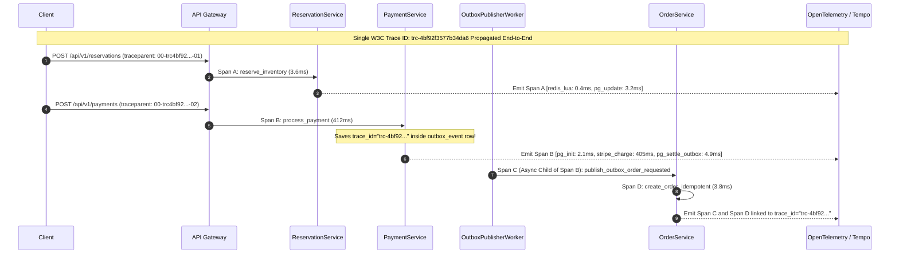

# Phase 8B: Security & Observability Architecture
**Project:** SALESTORM — High-Concurrency Flash-Sale E-Commerce Platform  
**Event:** SYSCRAFTERS 2026 (Design-First System Design Hackathon)  
**Team:** Team 1  

---

## 1. Defense-in-Depth Security Architecture

Flash sales are prime targets for scalper bots, credential-stuffing attacks, replay attacks, and parameter tampering (e.g., sending `quantity = -1` to inflate stock). SALESTORM enforces security across **seven layers**:

```mermaid
flowchart LR
    REQ["Incoming Client Request"] --> L1["1. Edge WAF and Bot Shield (TLS 1.3, DDoS, Turnstile)"]
    L1 --> L2["2. Rate Limiter and Waiting Room (IP + customer_id Token Bucket)"]
    L2 --> L3["3. AuthN / AuthZ API Gateway (RS256 JWT + RBAC Scope)"]
    L3 --> L4["4. Strict Input and Header Validation (Pydantic/OpenAPI + Idempotency-Key)"]
    L4 --> L5["5. PCI-DSS Tokenized Payment (pm_tok_* only; Zero PAN/CVV)"]
    L5 --> L6["6. mTLS and Secrets Vault (Service Mesh + KMS / Vault)"]
    L6 --> L7["7. Immutable Audit Trail (audit_log table with trace_id)"]
```



### 1.1 Security Controls Specification

| Security Domain | Implementation in SALESTORM | Threat Mitigated |
| :--- | :--- | :--- |
| **1. Authentication (AuthN)** | Stateless OAuth2 / OIDC **JWT (`RS256` asymmetric signature)** verified at the API Gateway using cached JWKS public keys (`15-minute` access token expiry). | Prevents unauthenticated bot floods from reaching `ReservationService` or `PaymentService`. |
| **2. Authorization (AuthZ) & Ownership Checks** | Role-Based Access Control (`CUSTOMER`, `SRE_ADMIN`, `INTERNAL_WORKER`) + **Object-Level Ownership Guard**: `POST /api/v1/payments` verifies `reservation.customer_id == jwt.sub` (`403 Forbidden` on mismatch). | Prevents Broken Object Level Authorization (BOLA / IDOR) where User B tries to pay for User A's winning `reservation_id`. |
| **3. Transport Encryption (TLS / mTLS)** | External traffic enforces **TLS 1.3** (HSTS enabled) at Cloudflare/ALB. Internal service-to-service traffic (API Gateway $\rightarrow$ Reservation $\rightarrow$ Payment $\rightarrow$ PostgreSQL/Kafka) uses **mTLS** via Istio/Linkerd service mesh. | Eliminates man-in-the-middle (MITM) eavesdropping and unauthorized lateral movement inside the VPC. |
| **4. Multi-Tier Rate Limiting** | **Tier 1 (Edge/IP):** Max `50 req/10s` per IP for catalog reads. **Tier 2 (Authenticated `customer_id`):** Max `5 req/sec` on `POST /api/v1/reservations` and `2 req/sec` on `POST /api/v1/payments` (Redis sliding-window counter). | Stops scalper scripts from firing 10,000 requests from a single user account while allowing legitimate retry clicks. |
| **5. Input Validation & Anti-Tampering** | Strict schema validation (Pydantic v2 / OpenAPI): `quantity` must be integer `== 1` (flash-sale cap), `Idempotency-Key` must match `^[a-zA-Z0-9-_]{8,128}$`, and prices are **never read from the client request body** (always locked from `sale_deal.sale_price` on the server). | Blocks negative-quantity stock injection (`quantity: -5`), SQL injection (100% parameterized queries), and client-side price manipulation. |
| **6. PCI-DSS Payment Data Handling (Tokenization)** | **Hard Guarantee (`NFR-SEC-01`):** Client browser/app collects card details directly inside Stripe Elements / Razorpay Checkout iframe and exchanges them for a single-use token (`pm_tok_visa_4242`). SALESTORM servers, logs, and databases **only ever receive or store `pm_tok_*` and `provider_tx_id`**—never raw PAN, CVV, or expiry dates. | Reduces PCI-DSS compliance scope to SAQ-A and guarantees zero card-number leakage even in the event of a database breach. |
| **7. Secrets Management & Audit Logging** | Database credentials, JWT signing keys, and Stripe/Razorpay API keys are stored in **AWS Secrets Manager / HashiCorp Vault**, injected via Kubernetes CSI SecretStore driver into tmpfs memory (never committed to Git or `.env` files), and rotated every 30 days. All sensitive mutations append to `audit_log`. | Prevents credential leaks and provides a non-repudiable forensic trail for every stock and payment change. |

---

## 2. Observability Architecture (Metrics, Logs, Traces & Alerting)

In a distributed flash-sale pipeline spanning Redis, PostgreSQL, External Payment Gateways, and asynchronous Outbox workers, observability is essential to prove invariants and diagnose bottlenecks in real time.

### 2.1 Key Prometheus Metrics (`RED` + Business Invariant Gauges)

| Metric Name | Type | Labels | Purpose & Invariant Monitored |
| :--- | :--- | :--- | :--- |
| `salestorm_http_requests_total` | Counter | `service`, `endpoint`, `method`, `status_code` | Tracks total RPS and HTTP status breakdown (`201 Created`, `200 Replay`, `409 SOLD_OUT`, `402 Declined`, `503 CircuitOpen`). |
| `salestorm_http_request_duration_seconds` | Histogram | `service`, `endpoint` | Tracks `p50`, `p95`, and `p99` latencies against Phase 1 SLO targets (`p99 <= 150ms` for `/api/v1/reservations`). |
| `salestorm_inventory_quantity` | Gauge | `product_id`, `bucket` (`available`, `reserved`, `sold`) | Real-time stock conservation monitor: `sum(salestorm_inventory_quantity) == 100` at every scrape interval. |
| `salestorm_inventory_drift_units` | Gauge | `product_id` | Absolute difference `\|redis_stock - pg_available_quantity\|` computed every 5s by `StockReconciliationWorker`. **Must converge to `0`.** |
| `salestorm_outbox_pending_events` | Gauge | `event_type` | Queue depth of unpublished `outbox_event` rows (spikes during 30s `OrderService` outage, drains to `0` on recovery). |
| `salestorm_circuit_breaker_state` | Gauge | `target_service` (`OrderService`, `PaymentGateway`) | `0 = CLOSED`, `1 = HALF_OPEN`, `2 = OPEN`. |
| `salestorm_reservation_expired_total` | Counter | `product_id` | Count of abandoned reservations reclaimed by `ExpirySweeperWorker`. |

---

### 2.2 Structured JSON Log Examples (With Correlation `trace_id`)

Every log entry emitted by SALESTORM services and workers is structured JSON containing W3C TraceContext fields (`trace_id`, `span_id`), `service`, `event`, and domain identifiers—never PII or raw card details:

#### Example 1: Winning Reservation (`ReservationService`)
```json
{
  "timestamp": "2026-10-12T09:15:00.114Z",
  "level": "INFO",
  "service": "ReservationService",
  "trace_id": "trc-4bf92f3577b34da6a3ce929d0e0e4736",
  "span_id": "spn-00f067aa0ba902b7",
  "event": "INVENTORY_RESERVED",
  "customer_id": "cust_00101",
  "product_id": "PRODUCT_X",
  "reservation_id": "res_77112233-4455-6677-8899-aabbccddeeff",
  "idempotency_key": "idem-cust101-001",
  "idempotent_replay": false,
  "redis_gate_latency_ms": 0.42,
  "db_tx_latency_ms": 3.18,
  "remaining_available_stock": 0,
  "inventory_version": 100
}
```

#### Example 2: Circuit Breaker Tripping `OPEN` During 30s `OrderService` Outage (`OutboxPublisherWorker`)
```json
{
  "timestamp": "2026-10-12T09:15:06.890Z",
  "level": "WARN",
  "service": "OutboxPublisherWorker",
  "trace_id": "trc-4bf92f3577b34da6a3ce929d0e0e4736",
  "span_id": "spn-99aabbccddeeff00",
  "event": "CIRCUIT_BREAKER_TRIPPED_OPEN",
  "target_dependency": "OrderService",
  "consecutive_failures": 5,
  "cooldown_seconds": 10,
  "affected_outbox_event_id": "e4d909c2-90d0-4899-9843-778899aabbcc",
  "reservation_id": "res_77112233-4455-6677-8899-aabbccddeeff",
  "scheduled_next_retry_at": "2026-10-12T09:15:17.120Z",
  "message": "OrderService unreachable; circuit tripped OPEN. Outbox event safely persisted in PENDING state."
}
```

---

### 2.3 Distributed Tracing Across Checkout $\rightarrow$ Payment $\rightarrow$ Outbox $\rightarrow$ Order

Using **OpenTelemetry (W3C `traceparent` header)**, SALESTORM propagates a single `trace_id` across both synchronous HTTP calls and asynchronous Outbox/Kafka boundaries (by storing `trace_id` as a column in `outbox_event` and Kafka message headers):



---

### 2.4 Production Alerting Rules (Prometheus Alertmanager / PagerDuty)

| Alert Name | Severity | PromQL / Trigger Condition | Automated & Human Remediation Action |
| :--- | :--- | :--- | :--- |
| **`CRITICAL_InventoryConservationViolated`** | **P0 (Page Immediately)** | `(salestorm_inventory_quantity{bucket="available"} + salestorm_inventory_quantity{bucket="reserved"} + salestorm_inventory_quantity{bucket="sold"}) != 100` OR `salestorm_inventory_quantity{bucket="available"} < 0` | Immediately halt flash-sale admission at API Gateway; trigger `StockReconciliationWorker` full ledger audit. |
| **`HIGH_RedisPostgresInventoryDrift`** | **P1 (Page SRE)** | `salestorm_inventory_drift_units > 0` for `> 10 seconds` (persisting across $> 2$ consecutive 5s checks) | `StockReconciliationWorker` only heals drift that persists for $> 10\text{ seconds}$ (2 consecutive checks with matching `inventory.version`), preventing false overwrites during the 3ms window when a reservation is between Redis Lua decrement and PostgreSQL commit. |
| **`HIGH_PaymentGatewayFailureSpike`** | **P1 (Page SRE)** | `rate(salestorm_payment_outcomes_total{status="FAILED_5XX"}[1m]) / rate(salestorm_payment_outcomes_total[1m]) > 0.10` | `CircuitBreakerProxy` trips `OPEN`; `PaymentGatewayFactory` switches active provider from Primary (`STRIPE`) to Secondary (`RAZORPAY`). |
| **`WARN_OutboxQueueBacklogGrowing`** | **P2 (Warn / Slack + Auto-Scale)** | `salestorm_outbox_pending_events > 50` or oldest `PENDING` event age `> 20 seconds` | KEDA automatically scales `OutboxPublisherWorker` and `OrderService` pods; alerts SRE if `OrderService` circuit breaker remains `OPEN` $> 30\text{s}$. |
| **`CRITICAL_OutboxDeadLetterDetected`** | **P0 (Page Immediately)** | `increase(salestorm_outbox_dead_letter_total[5m]) > 0` | `DeadLetterHandler` initiates automated Gateway Refund Compensation Saga (`REFUNDED`) and pages on-call engineer with `trace_id`. |

---

## 3. Architectural Decisions for Phase 8B (Working Rule #3)

### Decision 8.2: Client-Side Gateway Tokenization (`pm_tok_*`) vs. Server-Side Card Proxying
* **Choice:** Require clients to tokenize payment details directly with the external gateway (Stripe Elements / Razorpay SDK) and submit only the opaque token (`pm_tok_*`) to `POST /api/v1/payments`.
* **Alternatives Rejected:**
  1. *Sending raw 16-digit card numbers and CVV through SALESTORM's API Gateway and `PaymentService`.*
* **Why it fits SALESTORM:** Eliminates 100% of raw cardholder data from SALESTORM's memory, structured logs, Kafka events, and PostgreSQL tables (`NFR-SEC-01` Hard Guarantee), keeping the flash-sale microservices lightweight and PCI-DSS SAQ-A compliant.
* **What it sacrifices:** Requires the frontend web/mobile client to integrate the payment provider's lightweight tokenization SDK prior to calling `POST /api/v1/payments`.
